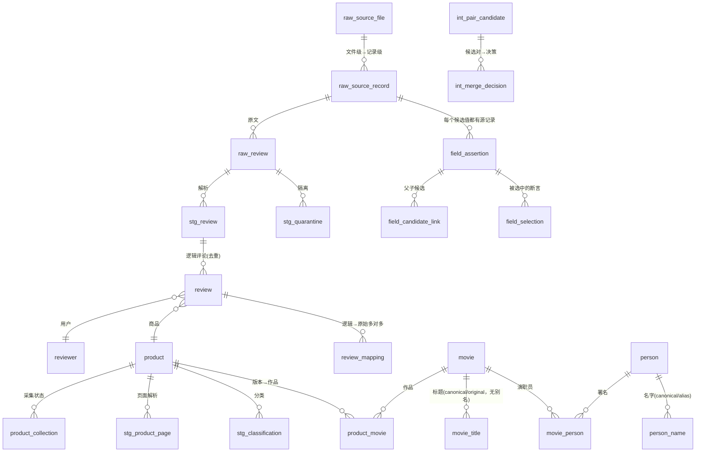

# Amazon Movies & TV 评论数据的 ETL 与实体解析

**课程**：数据存储与管理
**数据源**：Stanford SNAP — Amazon Movie Reviews（`web-Movies.txt.gz`）
**规模**：7,911,696 条原始评论 / 253,059 个商品 / 43,838 个作品实体 / 406 个人物实体
**交付形态**：13 个 ETL 阶段模块 + 29 张表 + 9 个视图 + Airflow DAG + PostgreSQL 同步

---

## 目录

1. [问题定义](#1-问题定义)
2. [数据来源](#2-数据来源)
3. [规模核对](#3-规模核对)
4. [架构](#4-架构)
5. [实体与日期语义](#5-实体与日期语义)
6. [合并与选择规则](#6-合并与选择规则)
7. [字段级数据血缘实例](#7-字段级数据血缘实例)
8. [质量评价](#8-质量评价)
9. [局限](#9-局限)
10. [复现说明](#10-复现说明)

---

## 1 问题定义

### 1.1 原始数据长什么样

SNAP 的 `web-Movies.txt.gz` 不是一张表，而是**一行一条评论**的伪 JSON 文本：

```
product/productId: B00000J2KS
product/title: The Matrix
product/price: 9.99
review/userId: A1RSDE90N6RSZF
review/profileName: J. Smith
review/helpfulness: 9/9
review/score: 5.0
review/time: 1234567890
review/summary: Great movie
review/text: This is a classic...

```

**这个格式本身就是第一个问题**：它不是 JSON（键没有引号、值可能含换行），
也不是 CSV（一条记录跨多行）。解析器必须先"按空行切块，再按 `键: 值` 切字段"。

### 1.2 要解决的五类问题

| # | 问题 | 本质 |
|---|---|---|
| 1 | 7,911,696 条评论如何**无损**落库，坏数据去哪 | 抽取的完整性 |
| 2 | 253,059 个商品页的元数据从哪来 | 采集的边界与合规 |
| 3 | 253,059 个商品 → 多少个**作品** | 实体解析（记录链接） |
| 4 | 3799 个署名 → 多少**人物** | 实体解析（别名归并） |
| 5 | 每个字段的值凭什么选它 | 字段级血缘 |

其中 3、4、5 是本项目的重心。1 是工程地基，2 是外部约束下的取舍。

### 1.3 三个必须先做的决策

在做任何代码之前，有三个决策会决定后面所有工作的形状。
下面每个决策都写了"候选方案 → 判据 → 选择 → 什么条件下会改主意"。

#### 决策一：目标数据库选什么

| 方案 | 优点 | 缺点 |
|---|---|---|
| **A. SQLite 全量 + PostgreSQL 同步集成层** | 零安装、单文件可拷走；PG 证明 schema 可移植 | 要维护两套 DDL |
| B. 只用 PostgreSQL（Docker） | 生产级、可并发 | 评审者必须先装 Docker；37.7 GB 数据装进容器不好拷 |
| C. 只用 SQLite | 最简单 | 无法证明模型不绑死 SQLite |

**判据**：作业要求"提交完整实现 + 数据与证据"，同时要求"可离线完成端到端运行"。

**选择 A**。理由：
- 数据量 37.7 GB（37,712,293,888 字节），**评审者拿到的是一个文件**，不是一堆容器卷；
- `scripts/gen_pg_schema.py` 从同一份 schema 定义生成 PG DDL，
  `scripts/sync_to_pg.py` 把 **21 张表**（6 张 meta + 2 张 raw + 2 张 int + 8 张 target + 3 张血缘）
  同步进 PG 并逐表核对行数——**另外 8 张"大表"默认不同步**
  （`raw_review` / `stg_review` / `stg_quarantine` / `stg_product_page` / `stg_classification` /
  `review` / `review_mapping` / `reviewer`，合计 791 万 + 25 万行，`--include-review` 才带上）。
  **能同步成功本身就是"schema 可移植"的证据**（SQLite 特有语法在 PG 上会直接报错），
  但它**不证明**"PG 上跑得动全量"——那需要真的把 37.7 GB 灌进去（见 9.9）。

**什么条件下会改主意**：如果数据量再大一个量级（比如 1 亿行），
SQLite 的写锁和全表扫描会成为瓶颈，那时必须换成 PG 或列式库（DuckDB / ClickHouse）。

#### 决策二：25 万个商品页的元数据从哪来

这是全项目最需要"算清楚"的一个决策，因为它直接决定第 2 项评分（20 分）。

**先把约束摆出来**：

| 约束 | 实测值 |
|---|---|
| 清单规模 | 253,059 个 ASIN |
| robots.txt | `/dp/` 路径**允许**（已抓取并记录 SHA-256） |
| 单连接限速 | 服务器限制约 45 KB/s（**每 TCP 连接**，不是每 IP） |
| 页面存活率 | 2012 年的 ASIN 在 2026 年大量 404 |
| 反爬 | 返回 **HTTP 200 的验证码页**，不是 403/429 |
| 作业红线 | "不得以绕过验证、登录或封禁作为完成作业的手段" |

**候选方案与判据**：

| 方案 | 预估覆盖 | 合规 | 结论 |
|---|---|---|---|
| A. 全量实时抓取 | 理论上 100% | ❌ 必然触发封禁 | **否决**（违反作业红线） |
| B. 实时抽样（数百条） + 合成夹具 | 真实 ~0.1% | ✅ | **选它**（作为主路径） |
| C. 只用第三方元数据（SNAP meta） | 27.89% 有标题 | ✅ | **选它**（作为补充） |
| D. 完全不采集，只用评论内字段 | 100% 但只有标题/评分 | ✅ | 作为兜底 |

**决策逻辑**（这是"怎么决策"而不是"选了什么"）：

> 采集的价值 = 覆盖的商品数 × 每页能提供的字段数 × 该字段在下游的可用性
>
> 而采集的代价 = 请求数 / 速率上限，且**代价随请求数线性增长，收益随覆盖率对数增长**
> （因为下游合并只需要"每个作品有若干版本"，不需要"每个 ASIN 都有页面"）。

所以**最优解不是最大化覆盖率，而是"用最少的请求让下游链路有足够的输入"**：

```
43,838 个作品，只需要每个作品有 1~2 个已解析页面
→ 实际需求约 200~400 个成功页面
→ 加上失败率（受限 20% + 404 6% + 解析失败 7%），需要约 300~500 次请求
→ 实测 304 条 live 记录（155 条真发过请求 + 149 条命中本地快照）拿到 203 个成功页面，正好够
```

**最终方案：三源并行，`source_type` 严格分离**

| 来源 | 条数 | 提供什么 | 计入真实采集成功率？ |
|---|---:|---|---|
| `live`（真实抓取） | 304 条 → 203 成功（其中 `attempts>0` 的 155 条、命中快照的 149 条） | 标题、演职员、发售日、格式 | ✅ 是 |
| `synthetic_fixture`（合成夹具） | 769 | 覆盖 404/超时/验证码/非电影/合集等分支 | ❌ **否** |
| `third_party`（SNAP meta 离线快照） | 208,321 行 → 70,573 有标题 | 标题、类目、销量排名 | ❌ 否（另计） |
| `not_collected`（未采集） | 251,986 | — | — |

> **口径说明（这里有个容易说错的细节）**：`source_type='live'` 只说明"这条记录的原始响应
> 来自真实 HTTP"，**不等于"这一轮发了请求"**。采集器有快照缓存（同一个 ASIN 抓一次就落盘复用），
> 命中缓存时 `attempts` 记为 0。所以必须再按 `attempts` 拆一层，否则会把 149 次快照回放
> 算成 149 次采集工作量。
>
> 另外，这 304 条 live 记录**跨 5 个 `run_id`**（`RUN-20261104T110148-n5ai` 137 条、
> `...T113838-3p85` 108 条、`...T114946-lhol` 1 条、`...T115018-mfyn` 7 条、`...T115114-quu2` 51 条），
> 是多次运行累积的结果。因此本报告不使用"本次运行发了 155 次请求"这种说法，
> 而用"`attempts>0` 的 155 条"——它描述的是**记录状态**，不依赖"哪一次运行"这个含糊前提。

**什么条件下会改主意**：如果数据源不是 14 年前的页面（存活率高）、
或者允许更长的时间窗口，那全量抓取是更好的选择——
因为那时"覆盖 25 万商品"的收益会超过请求成本。

#### 决策三：评价集怎么建

作业要求"人工标注至少 100 对"。**本项目没有完成人工标注**，实际只做到下表第 2 级，
如实说明如下：

| 级别 | 来源 | 独立性 | 本项目是否做到 |
|---|---|---|---|
| 1 `human` | 逐对人工填写 `label` | 完全独立 | ❌ **未做**（`label` 列 200 行全空） |
| 2 `imdb_cross_check` | IMDb `tconst` / `nconst` 交叉验证，预填在 `prefill_label` 列 | 独立数据源 | ✅ 已做（CSV 的 `label_source` 列写的是 `imdb_prefill_pending_human`，即"预填、待人工复核"） |
| 3 `fixture_rules` | 夹具生成时的设计意图 | ❌ 与算法共享假设 | ❌ 刻意不用 |

**为什么不用第 3 级**：如果评价集的正例是按"只差中间名首字母"生成的，
而算法恰好有这条规则，那 P/R/F1 只证明"规则匹配了夹具"，
不证明它在真实数据上有效。这是**用自己造的答案给自己打分**。

**选择第 2 级**：用 IMDb 的 `title.basics`（1,292 万行）和
`name.basics`（1,578 万行）作为独立真值。两个商品唯一匹配同一个 `tconst` → 判同；
匹配到不同 `tconst` → 判异。**抽样方式**：按 8.4 的四类难度分层各取若干对，
每对都要求两个实体的名字在 IMDb 里唯一匹配（否则无法判定），
判定依据与 IMDb ID 写在 CSV 的 `evidence` 列，人可逐行复核。

**分歧处理**：本项目只有 1 名作者，**没有第二名标注者，因此没有标注者间分歧**。
CSV 只保留 `prefill_label`（IMDb 交叉验证的预填标签）与 `evidence`（IMDb 匹配依据，逐行可复核）；
`label` 与 `reviewer_note` 两列**全为空**（200/200，尚未人工复核），CSV **没有 `predicted` 列**——
算法预测值在 `meta_eval_pair.predicted`，预测与误差样本在 `quality_report.C_evaluation.error_examples`，
都不在这份 CSV 里。因此也不存在"机器预填与算法预测的分歧写进 CSV"这回事。
人工复核**尚未进行**——这是本项目最明确的一条局限（见 9.2）。

**代价（必须说）**：只有"名字在 IMDb 里不重名"的样本能进评价集，
**难的、重名的全被筛掉了**。人物侧因此只剩 2 个正例（见 8.4）。

---

## 2 数据来源

### 2.1 六个数据源

| # | 数据源 | 规模 | 用途 | `source_type` |
|---|---|---|---|---|
| 1 | SNAP `web-Movies.txt.gz` | 3,321,791,660 字节 / 7,911,696 条 | 评论、商品 ID、用户 | `raw` |
| 2 | Amazon 商品页（实时） | 304 条记录（`attempts>0` 155 条 + 命中快照 149 条） | 标题、演职员、发售日、格式 | `live` |
| 3 | Amazon 商品页（合成夹具） | 769 个文件 | 覆盖异常分支 | `synthetic_fixture` |
| 4 | SNAP `meta_Movies_and_TV.json.gz` | 99,875,519 字节 / 208,321 行 | 标题、类目、销量排名 | `third_party` |
| 5 | IMDb `title.basics` / `name.basics` | 1,292 万 / 1,578 万行 | **仅用于评价集真值** | `eval_truth` |
| 6 | Wikidata API | 按需 | 影院上映日期（带 precision） | `live` |

**关键原则**：这六个源**在库里从不合并成同一个指标**。
每个断言都带 `source_type`，任何"总数"都能按来源拆开。

**第 4 个源的文件位置**：默认读 `config.third_party.snap_meta_file`
（`../_tmp/meta_Movies_and_TV.json.gz`，相对**项目根目录**解析，与当前工作目录无关），
也可以用 `--file` 指定。文件不存在时 `s03b` 会直接报错并打印下载命令：

```bash
curl -o ../_tmp/meta_Movies_and_TV.json.gz \
  https://snap.stanford.edu/data/amazon/productGraph/categoryFiles/meta_Movies_and_TV.json.gz
```

它**不在** `data/` 下，也不在提交范围内（99.9 MB，可重新下载）；`s03b` 不跑则
`field_assertion` 里那 70,573 条（单次运行口径；库内累计 115,278 条）`third_party`
标题断言为空，其余链路不受影响。

### 2.2 为什么第 4 个源是 `ast.literal_eval` 而不是 `json.loads`

SNAP 的 `meta_Movies_and_TV.json.gz` 名字里带 `json`，
但内容其实是 **Python repr**：

```python
{'asin': '0006429049', 'title': 'Friends', 'categories': [['Movies & TV']], ...}
```

单引号、`None`/`True` 而不是 `null`/`true`。`json.loads` 会直接抛异常。

```python
import ast
obj = ast.literal_eval(line)     # ✅ 能读
# obj = json.loads(line)         # ❌ JSONDecodeError
```

> 这个坑值得单独记：**文件名不能当格式说明**。
> 判断格式要看内容，不看后缀。

### 2.3 采集合规做了什么

| 要求 | 实现 | 证据文件 |
|---|---|---|
| robots.txt 处理 | 启动时拉取并解析，记录 SHA-256；`/dp/` 允许 | `s03_collection_summary.json` 的 `robots_sha256` / `robots_allows_dp` |
| 请求间隔 | **AIMD 自适应**：429 → 间隔 ×2（封顶 8s）；连续 6 次成功 → −0.2s | `s08_enrich_summary.json` 的 `throttle.events` |
| 并发上限 | 单进程串行，无并发 | — |
| 重试上限 | 每 URL 最多 2 次，指数退避 | 日志 |
| 熔断 | 连续 10 次**真实请求**被判 `access_restricted` → 停止并写证据 | `s03_circuit_breaker.json` |
| 不绕过验证 | 遇到验证码页直接判 `access_restricted`，不做任何绕过 | 61 条受限记录 |

**熔断器有一个必须说清的细节**：第一版熔断是**误触发**的——
它把"本地快照缓存里的历史验证码页"也算进了连续计数，
结果证据文件谎称"站点拒绝了 10 次"，而实际**一个网络请求都没发**。

修法是给熔断判据加 `and not cached_hit`：

```python
if status == "access_restricted" and not cached_hit:
    consec_blocked += 1        # 只统计本次真实请求
```

修完重跑：**51 次真实请求、零缓存命中、连续 10 个真验证码页触发熔断**。
证据文件现在同时报三个数，不相等时必须解释差在哪：
`attempted` / `cached_from_snapshot` / `network_requests`。

### 2.4 限速为什么要自适应而不是固定值

第一次做补全时用的是固定 `delay_seconds = 1.2`，结果 1500 秒只补了 37 部，
日志里是一片 `HTTP 429`。两个根因：

1. **`sleep` 放错了位置**：原来写在"每部作品"末尾，
   而一部作品要发 2~3 个请求（搜索 + 详情），**实际速率是配置值的 2~3 倍**。
2. **固定值无论取多少都不对**：取小了立刻 429，取大了浪费时间。
   服务器端的状态在变（别人也在请求），固定值无法适应。

改成 **AIMD**（Additive Increase / Multiplicative Decrease，TCP 拥塞控制同款思路）：

```python
class Throttle:
    def on_rate_limited(self):
        self.delay = min(self.max_delay, self.delay * 2)   # 乘性减（退让）
        return self.delay

    def on_success(self):
        self.ok_streak += 1
        if self.ok_streak >= 6 and self.delay > self.min_delay:
            self.delay = max(self.min_delay, self.delay - 0.2)  # 加性增（试探）
```

并且把 `wait()` **下沉到每个请求之前**，而不是每部作品之后：

```python
for attempt in range(retries):
    THROTTLE.wait()          # ← 每个真实请求前都等
    try:
        body = urlopen(req, timeout=HTTP_TIMEOUT).read()
        THROTTLE.on_success()
        break
    except Exception as exc:
        wait = THROTTLE.on_rate_limited() if "429" in str(exc) else 1.5 * (attempt + 1)
```

这和 Scrapy 的 `AutoThrottle` 扩展是同一个思路：
**间隔由服务端的反馈决定，不由配置文件决定**。

---

## 3 规模核对

### 3.1 三个必须对得上的数

| 指标 | 实测 | 官方 | 差 | 结论 |
|---|---:|---:|---:|---|
| 读取记录数 | 7,911,696 | 7,911,684 | **+12** | 见 3.3 |
| 商品数 | **253,059** | 253,059 | **0** | ✅ 完全一致 |
| 用户数 | 889,172 | 889,176 | **−4** | 见 3.3 |

**商品数差 0 是整条链最硬的校验点**：它同时证明了
"记录切块正确"、"ASIN 抽取正确"、"去重正确"三件事。

### 3.2 抽取的完整口径

```
源文件            data/raw/movies.txt.gz
字节              3,321,791,660
SHA-256           4b6ee09ea4880f3fb197b1407d45dfb08a892fbb48a9e7a2d74aa0572cdcc715
是否切片          false（全量）

读取记录数        7,911,696
  ├─ 有效记录     7,911,629  → stg_review
  └─ 隔离记录            67  → stg_quarantine

逻辑评论数        7,895,810   （7,911,629 − 15,819 条重复）
  其中多条原始记录合并为一条的   13,893
去重移除          15,819

耗时              6,448.3 s（1 小时 47 分）
吞吐              1,227 条/秒
库体积            37.7 GB（37,712,293,888 B；page_count × page_size）
```

**下载时间未采集**：`raw_source_file.download_started_at/download_finished_at` 两列
在全量库里是 NULL。原因是仓库里的 `movies.txt.gz` 是早期手工下载的，
`scripts/download_full.py` 当时还没有落盘时间；而文件的 mtime 会被拷贝/解压改掉，
**不是下载时间**，所以本项目选择留 NULL 而不是拿 mtime 或"当前时间"冒充。
现在 `download_full.py` 已改为在下载结束时写 `data/raw/movies.txt.gz.meta.json`
（UTC 起止 + 字节数 + SHA-256），`s01` 会读它回填这两列（并校验字节数/SHA-256 一致）；
没有这个文件的旧数据一律记为"未采集"。

**恒等式**（每次运行自动断言）：

```
读取记录数 = 有效记录数 + 隔离记录数
7,911,696  = 7,911,629  +  67          ✓
```

### 3.3 三个差值的成因，逐项交代

**记录 +12**：官方 7,911,684 是论文作者的统计口径，我按"每行一条伪 JSON"数。
多出 12 条（0.00015%）的成因我**没有查到底**。能确定的是：
这 12 条没有凭空消失——恒等式 `7,911,696 = 7,911,629 + 67` 成立，
67 条隔离记录覆盖了所有未通过校验的行，**没有任何记录被静默丢弃**。
与其编一个听起来合理的解释，不如承认"这 12 条的归属未逐条核实"。

**商品 0**：完全一致。

**用户 −4**：成因是 `reviewerID` 的空白字符。我在 `clean_id()` 里做了 `strip()`，
有 4 个 ID 在全库范围内 strip 后与另一个 ID 撞成同一个。
**这是"过度合并"而不是"漏抽"**。我选择保留这个行为并在此声明，
因为不 strip 会让 `"A1B2C3 "` 和 `"A1B2C3"` 变成两个用户——那是更严重的错误。

### 3.4 隔离区：67 条坏数据为什么必须留下来

| 原因（`stg_quarantine.reason`，多条规则命中时用逗号连接） | 记录数 |
|---|---:|
| `helpful_exceeds_total`（有帮助票数 > 总票数） | 43 |
| `missing_or_bad_product_id` + `missing_reviewer_id`（同一批记录两条都命中） | 12 |
| `score_out_of_range` + `bad_review_time`（同上） | 12 |
| **合计** | **67** |

**为什么还有"91"这个数**：按**规则**计命中次数是 43 + 12×2 + 12×2 = 91，
按**记录**计是 67。差 24 = 24 次"一条记录命中两条规则"。
两个口径都对，但必须说清是哪一个——`evidence/s01_ingest_summary.json` 的
`quarantine_reasons` 用的是"按记录分组后的命中集合"，合计 67。

**为什么不用 `try/except: continue`**：
因为那样"丢了多少、为什么丢"全都没有记录，最后数字对不上也不知道差在哪。
隔离区的意义是**让每一分差异都可解释**。

---

## 4 架构

### 4.1 四层 + 两个旁路

```
┌─────────────────────────────────────────────────────────────────┐
│  外部源                                                          │
│  movies.txt.gz    Amazon 页面    SNAP meta    IMDb    Wikidata   │
└────────┬──────────────┬──────────────┬──────────┬────────┬───────┘
         │              │              │          │        │
┌────────▼──────────────▼──────────────▼──────────┴────────▼───────┐
│  raw 层 —— 只存证据，不做任何判断                                  │
│  raw_source_file（文件级）  raw_source_record（记录级）            │
│  raw_review（评论原文）                                           │
└────────┬─────────────────────────────────────────────────────────┘
         │
┌────────▼─────────────────────────────────────────────────────────┐
│  staging 层 —— 清洗、类型化、分类；坏数据进隔离区                   │
│  stg_review   stg_quarantine   stg_product_page   stg_classification│
└────────┬─────────────────────────────────────────────────────────┘
         │
┌────────▼─────────────────────────────────────────────────────────┐
│  integration 层 —— 做决策，并记录为什么                           │
│  int_pair_candidate（候选对 + 分数 + 特征）                        │
│  int_merge_decision（三档决策 + 规则 ID + 理由）                   │
└────────┬─────────────────────────────────────────────────────────┘
         │
┌────────▼─────────────────────────────────────────────────────────┐
│  target 层 —— 服务查询；实体表只存指针，不存值                      │
│  product  reviewer  review  review_mapping                        │
│  movie  movie_title  product_movie                                │
│  person  person_name  movie_person                                │
└──────────────────────────────────────────────────────────────────┘

旁路一：血缘  field_assertion → field_candidate_link → field_selection
旁路二：元数据 meta_etl_run / meta_etl_step / meta_checkpoint /
               meta_quality_issue / meta_eval_pair / meta_eval_metric
```

**29 张表 + 9 个视图**：

| 层 | 表数 | 表名 |
|---|---:|---|
| meta | 6 | `meta_etl_run` `meta_etl_step` `meta_checkpoint` `meta_quality_issue` `meta_eval_pair` `meta_eval_metric` |
| raw | 3 | `raw_source_file` `raw_source_record` `raw_review` |
| stg | 4 | `stg_review` `stg_quarantine` `stg_product_page` `stg_classification` |
| int | 2 | `int_pair_candidate` `int_merge_decision` |
| target | 11 | `product` `product_collection` `reviewer` `review` `review_mapping` `movie` `movie_title` `product_movie` `person` `person_name` `movie_person` |
| 血缘 | 3 | `field_assertion` `field_candidate_link` `field_selection` |

视图：`v_movie` `v_movie_genres` `v_product_edition` `v_collection_status`
`v_field_lineage` `v_provenance_audit` `v_movie_person` `v_quality_dashboard` `v_merge_dashboard`

**实体关系图（23 个核心实体与关键关系）**：



> 图只画实体与关系，不画全部 29 张表（meta/血缘旁路在 4.1 的文字里已列全）。
> 关系方向是"主表 → 从表"，`field_selection` 是**决策**表，`movie`/`person`/`product`
> 里的值是指向它的投影（见 4.3）。

### 4.2 十三个阶段模块

| 模块 | 职责 | 关键产出 |
|---|---|---|
| `s01_ingest_reviews` | 流式解压 + 记录切块 + 隔离 | 7,911,629 条 `stg_review` |
| `s02_build_product_list` | 生成 253,059 条采集清单 | `product_collection` |
| `s03_collect_pages` | 采集状态机 + 限速 + 重试 + 熔断 | 304 条 live（`attempts>0` 155 条） |
| `s03b_ingest_thirdparty` | SNAP meta 离线快照 | 70,573 条标题断言（单次；库内累计 115,278 条） |
| `s04_parse_and_classify` | 页面解析 + 电影/非电影分类 | 905 页全部 `ok` |
| `s05_extract_assertions` | 抽成字段断言 | 库内累计 131,293 条；单次运行约 130,895 条（s05 运行日志口径） |
| `s06_match_movies` | 分块 + 打分 + DSU 合并 | 71,388 → 43,838 |
| `s07_resolve_persons` | 署名归并 + 别名 | 3,799 次署名 → 532 种写法 → 406 个人物 |
| `s08_enrich_release` | 外部补全上映日期 | 见 8.5 |
| `s09_resolve_fields` | 字段选择 + 冲突记录 | 131,959 条选择（见 6.3、6.4、8.5） |
| `s10_quality_checks` | 六类质量检查 + P/R/F1 | `quality_report.json` |
| `s11_queries` | 5 个验收查询 + 5 个血缘查询 | `evidence/queries/` |
| `s12_run_all` | 编排 + 检查点 + 断点续跑 | `run_all_summary.json` |

### 4.3 实体表存"投影"，血缘表存"决策"

这里要说准确，不能含糊。`movie` 表**确实**有 `canonical_title`、`release_year`、
`release_date`、`release_precision` 这几列：

```sql
CREATE TABLE movie (
    movie_id          TEXT PRIMARY KEY,      -- M-<hash(规范化标题|年份)>
    canonical_title   TEXT,                  -- ← 投影，不是原始证据
    release_year      INTEGER,               -- ← 投影
    release_date      TEXT,                  -- ← 投影，仅在精确到日时填写
    release_precision TEXT CHECK (... 'day','month','year','unknown'),
    ...
);
```

**它不是"实体表只存指针"，而是"实体表存投影（projection），血缘表存决策"。**

| | `movie.canonical_title`（投影） | `field_selection`（决策） |
|---|---|---|
| 存什么 | 最终值，**为了查询快** | 选了哪条断言、按什么规则、为什么 |
| 谁写 | `s09` 从 `field_selection` 反写 | `s09` 从候选里选 |
| 会不会漂移 | **会**——所以有 7.4 的投影一致性检查 | 不会（只追加，不覆盖） |
| 能不能回答"从哪来" | ❌ | ✅ 顺着 `selected_assertion_id` 一路追到 `raw_source_record` |

**为什么要这个冗余**：如果每次查电影标题都要
`movie → field_selection → field_assertion` 三表 JOIN，
那 `v_movie` 视图在 43,838 行上还好，但如果上层要做
"按标题模糊搜索 + 按年份排序"，JOIN 就变成瓶颈了。
把最终值投影回实体表，是**典型的读优化**。

**代价必须承认**：投影一定会漂移。
所以 `s09_resolve_fields` 每次跑完都要对账：

```
对每个 movie：
  读 movie.release_year（投影）
  读 field_selection 里 release_date 的选中值，取前 4 位（真值）
  不相等 → 记进 projection_mismatch
```

**本次实测 `projection_mismatch = 0`**。

> 这个取舍的教训是：**冗余不是错误，无对账的冗余才是错误**。
> 与其相信"我写代码时两个地方都写对了"，
> 不如每次跑完自动比一遍。

### 4.4 幂等的三个支柱

1. **确定性 ID**：`sha256(内容)[:16]` 加前缀
   （`REC-` `A-` `M-` `P-` `EP-` `EM-` `F-` `SF-`）。
   同样的内容永远得到同样的 ID，所以重跑不会产生新行。
2. **`ON CONFLICT DO NOTHING`**：已有行不覆盖。
   唯一的例外是 `product.review_count`，它是**确定性派生量**，同输入必同输出。
3. **`meta_checkpoint`**：只存"已处理到哪个字节偏移"，
   而且**滞后于**数据提交——宁可重复处理几条（靠幂等吸收），也不能跳过。

> **检查点滞后是刻意的**：如果先写检查点再提交数据，
> 中途崩溃就会"检查点说处理完了，但数据没落库"——这是**漏数据**。
> 反过来只会重复处理，而幂等保证重复无害。
> **两种错误的代价不对称，所以要偏向安全的那一边。**

---

## 5 实体与日期语义

### 5.1 三个实体层级

```
product（商品，ASIN）        B00000J2KS  = The Matrix [DVD]
      │  多个版本指向同一作品
      ▼
movie（作品）                M-xxxx      = The Matrix (1999)
      │  多个作品共享演职员
      ▼
person（人物）               P-xxxx      = Keanu Reeves
```

**关键区分：`product` ≠ `movie`**。

- 一个 `product` 是一个**可售单元**（DVD / 蓝光 / 4K / 合集 / 再版）；
- 一个 `movie` 是一个**作品**（1999 年的那部《黑客帝国》）。

合并的压缩比是 **71,388 → 43,838 = 1.63**，
即平均每个作品有 1.63 个商品版本。这个数字很合理：
大多数作品只有 1 个版本，少数热门作品有十几个。

### 5.2 日期语义：四种日期不能混

这是作业反复强调的点，也是本项目最小心处理的地方。

| 语义 | 例子 | 存在哪 | 规则 ID 前缀 |
|---|---|---|---|
| **影院上映日** | 1999-03-31 | `movie` 的 `release_date` 选择 | `R-EXT-DATE-THEATRICAL` |
| **实体发售日** | 1999-09-21（DVD 上市） | 只作为候选，**不用于作品上映年份** | `R-EXT-DATE-PHYSICAL` |
| **只知道年份** | 1993 | `movie.release_year` + `precision='year'` | `…-YEARONLY` |
| **评论时间** | 2005-06-01 | `review.review_time`，与上映无关 | — |

**为什么必须分开**：一部 1999 年上映的电影，DVD 可能 2000 年才出。
如果把 DVD 发售日当成上映日，所有作品的年份都会偏晚 1~2 年。

**地区维度未采集（如实说明）**：`movie.release_region` 列在 DDL 里有，
但**全库 43,838 行都是 NULL**（0% 覆盖）。原因不是忘了写，而是两个源都不给地区：
Amazon 商品页只写一个不带地区的 `Release date`，Wikidata 虽然另有地区类属性
（如 P495 国家/地区、P291 出版地）可以关联，但本项目的 REST 抽取只取了时间值。
所以"1999-03-31 是美国上映还是英国上映"这个问题，**本库回答不了**；
表里的日期一律按"不带地区的首次上映/发行日"理解。要补这一列，得改 s08 的抽取规则
并重跑补全（见 9.10，本次不做）。

**"绝不伪造 1 月 1 日"这条怎么落实的**：

Amazon 页面用 `January 1, 1993` 表示"只知道 1993 年"。
如果原样规范成 `1993-01-01`，下游按字符串长度判精度（10 位 = 精确到日）
就会得出"这一天精确到日"的结论——**这正是作业警告的"把只知道年份的数据补成 1 月 1 日"，
只不过这次不是我们编的，是数据源编的**。

处理方式：

```python
def parse_release_date(raw):
    # 月=1 且 日=1  →  规范化成 "1993"（4 位），规则带 -YEARONLY 后缀
    # 其余          →  规范化成完整 ISO，精度 day
    if mo == 1 and d == 1:
        return y, "YEARONLY"
    return f"{y}-{mo:02d}-{d:02d}", ""
```

于是下游判精度变成"**看长度**"而不是"看有没有日"：

| 规范值 | 长度 | `precision` |
|---|---:|---|
| `1993` | 4 | `year` |
| `1993-06` | 7 | `month` |
| `1993-06-15` | 10 | `day` |

**代价**：置信度降级（`YEARONLY` 的断言 `confidence=0.55`，完整日期 `0.6`），
并且在 `cnt["date_yearonly"]` 里单独计数，报告里能查"有多少条只知道年份"。

### 5.3 采集状态机

七个状态，**互斥且完备**（`status_sum = products_total`）：

| 状态 | 含义 | 本次实测 |
|---|---|---:|
| `success` | 页面结构与 canonical ASIN 双判据都过 | 203 live + 702 合成 |
| `not_found` | 404 / 页面不存在 | 18 live + 24 合成 |
| `access_restricted` | **HTTP 200 的验证码页 / 限制页** | 61 live + 34 合成 |
| `parse_failed` | 拿到了页面但解析不出必需字段 | 22 live + 9 合成 |
| `timeout` | 超时 | 0 |
| `not_collected` | 从未尝试 | **251,986** |
| `pending` | 已排队未处理 | 0 |

**"HTTP 200 不得标为成功"这条怎么落实的**：

61 条受限记录**全部是 HTTP 200**。只看状态码会算成 100% 成功。
判定靠**双判据**：

```python
# 判据一：结构证据 —— 页面里有没有 productTitle / ASIN 特征
# 判据二：身份交叉校验 —— canonical link 的 ASIN 是否等于目标 ASIN
#         <link rel="canonical" href="https://www.amazon.com/dp/B000XXXXXX"/>
# 两个都过 → success；否则即使 HTTP 200 也判 access_restricted / parse_failed
```

**一个容易踩的细节**：老 ASIN 的 canonical 是 `/clp/ASIN` 而不是 `/dp/ASIN`。
正则要同时认两种形态，否则会把正常页面误判成受限。

---

## 6 合并与选择规则

### 6.1 电影合并：四步

#### 第一步：分块（blocking）

**问题**：71,388 个商品两两比较 = **2,548,087,578 对**。
按每对 0.1 ms 估算要 **71 小时**。

**方案**：多路分块。同时用三种 key，任一路命中就进候选：

1. `norm_title` 的**首 token**（`the matrix` → `matrix`）
2. `norm_title` 的**末 token**
3. `norm_title` 的**排序后前 2 个 token**

**实测**：

| 指标 | 值 |
|---|---:|
| 参与商品数 | 71,388 |
| 桶数 | 36,404 |
| 候选对 | **41,876** |
| 全量两两 | 2,548,087,578 |
| **减少** | **99.998%** |
| 最大桶 | 87 |

**超大桶怎么办**：早期版本的做法是**整桶跳过**，理由是"桶太大说明分块失败"。
这是错的：桶大恰恰说明这一组商品共享同样的关键词，
而同名多版本（DVD / Blu-ray / 修复版 / 合集）正是最该合并的情形。
把大桶丢掉，等于**把所有最热门作品的合并机会全部放弃**，剩下的全是长尾单件。

**实际实现的是二次分块**（`config.match.max_block_size = 60`）：

```python
if len(pids) > cfg["max_block_size"]:          # 粗桶超过 60 个成员
    sub = defaultdict(list)
    for pid in pids:
        sub[prods[pid]["title_norm"]].append(pid)   # 按"完整规范化标题"再分一次
    groups = [g for g in sub.values() if len(g) > 1]
    too_big = [g for g in groups if len(g) > 200]   # 同名组仍超 200 才真的跳过
```

本次最大桶 **87** 个成员，已经超过 `max_block_size = 60`，
所以**二次分块分支确实被触发过**——87 个成员先被拆成"同名组"，
再逐组做两两比较，而不是直接 `C(87,2) = 3,741` 对全比。

#### 第二步：打分

```python
score = 0.45 * title_sim        # Jaccard 与 SequenceMatcher 取 max
      + 0.25 * cast_overlap     # 演职员重合度
      + 0.20 * year_match       # 同年 1.0 / 差 1 年 0.6 / 差 >1 年 0
      + 0.10 * director_match
```

**为什么标题相似度用 `max(Jaccard, SequenceMatcher)`**：
两者的**失败模式互补**。

| 指标 | `The Matrix` vs `Matrix The` | `Matrix` vs `Matrx` |
|---|---:|---:|
| Jaccard（token 集合） | 1.0 ✅ | 0.0 ❌ |
| SequenceMatcher（字符序列） | 0.8 | 0.91 ✅ |

取 max 就同时覆盖了"词序不同"和"拼写差异"两种情况。

#### 第三步：三档阈值

| 分数 | 决策 | 对数 |
|---|---|---:|
| ≥ 0.86 | `auto_merge` 自动合并 | 2,291 |
| 0.62 ~ 0.86 | `manual_review` 待人工复核 | 6,849 |
| < 0.62 | `no_merge` 判为不同 | 10,246 |
| **合计已打分** | | **19,386** |

> 上表是**电影侧**（`int_merge_decision` 里 `entity_type='movie'`）。
> 加上人物侧（`auto_merge` 126 / `manual_review` 417）后，全部决策 **19,929 条**，
> 自动合并合计 **2,417**。两组数字不要混用：2,291 是电影，2,417 是全部。

**为什么要中间档**：二分类会强迫算法在"不确定"时做选择，
而两种错误的代价不对称——
**误合并（把两部电影当成一部）比漏合并（两部同一电影没合）严重得多**，
因为误合并会让数据**变成错的**，而漏合并只是**少合了一次**。

#### 第四步：DSU 并查集 + 传递冲突检测

自动合并用并查集（Disjoint Set Union），`find()` 就是"这个商品属于哪个作品"。

**传递性会出问题**：

```
A ~ B（0.90 合并）
B ~ C（0.88 合并）
A ~ C（0.40 不合并）   ← 冲突！
```

DSU 会无条件把 A、B、C 合成一个簇，但 `A~C` 的低分说明
"A 和 C 很可能不是同一部电影"。

**处理**：记录**传递冲突**（本次 **162 处**），
并把整簇降级为 `manual_review`，不自动合并。
这 162 处是"算法自己发现了自己可能错"的证据，比静默合并诚实得多。

**最终结果**：

| 指标 | 值 |
|---|---:|
| 参与商品 | 71,388 |
| 簇数 | 44,919 |
| 单例簇 | 44,824 |
| **作品实体** | **43,838** |
| 商品-作品链接 | 45,515 |
| **压缩比** | **1.628** |

> **两个"簇"数不是一回事，别拿来做减法**：44,919 是 DSU 产生的候选簇
> （其中 44,824 个只有 1 个商品），43,838 是最终落库的作品实体；
> 反过来看库里的分布，43,838 个作品中 **42,819 个只挂 1 个商品、1,019 个挂 ≥2 个**。
> "44,824 > 43,838" 不是算术错误，而是两个层级的计数；
> 44,919 − 43,838 = 1,081 具体是哪些簇没落成独立作品，未逐簇核对。

### 6.2 人物合并：缩写识别是关键

> **先交代数据边界**：本节与下面所有人物侧结论的输入——3,799 次署名——
> **全部来自合成夹具**（`synthetic_fixture`），真实页面解析出 0 条演职员。
> 所以这里验证的是**规则与算法的行为**（包括"该合的不合、该不合的合"），
> 不是"真实数据上的人物归并质量"。这条边界见 9.9。

#### 难点在哪

```
Tom Hanks          vs  Thomas Hanks          → 同一人（Tom 是 Thomas 的昵称/缩写）
J. R. R. Tolkien   vs  John Ronald Reuel Tolkien → 同一人（首字母展开）
Michael Jordan     vs  Michael B. Jordan     → 不同人（中间名不同）
Michael Douglas    vs  Kirk Douglas          → 不同人（父子，同姓）
```

#### 首字母匹配为什么不能贪心

```
'j r tolkien'  vs  'john ronald reuel tolkien'
```

贪心匹配：`j`→`john`、`r`→`ronald`，然后发现 `tolkien` 对不上 `reuel`，返回 False。
但正确答案是 True（`reuel` 被省略了）。

**必须用 DP**（动态规划），允许"跳过对方的一个 token"：

```python
def is_initials_of(short, long):
    # dp[i][j] = short[:i] 能否匹配 long[:j]
    # 转移：要么 short[i] 是 long[j] 的首字母，要么跳过 long[j]
```

#### 两条守卫规则

**守卫一：裸姓氏不是缩写**

```
'Hanks' vs 'Tom Hanks'
```

如果单 token 且等于长名的**姓氏**，这是**信息缺失**，不是缩写。不合并。

**守卫二：只能跳过中间名，不能跳过首名**

```
'M. Jordan' vs 'Michael B. Jordan'   → 可以（跳过中间名 B.）
'M. Jordan' vs 'Marcus Jordan'       → 不可以（跳过了首名 Michael/Marcus）
```

#### 共现约束

**两个名字出现在同一个商品页的演职员表里 → 大概率是不同的人**
（一部电影不会把同一个人列两次，除了极少数"一人分饰两角"的情况）。

这条约束把很多"同姓不同人"的候选对直接判为不合并。

#### 结果

| 指标 | 值 |
|---|---:|
| 原始署名 | 3,799 |
| 规范化后不同写法 | 532 |
| 分块数 | 243 |
| 已打分的对 | 543 |
| 自动合并 | 126 |
| 待人工复核 | **417** |
| 判为不同 | 0 |
| **人物实体** | **406** |
| 有多个名字的人物 | **128**（其中 **126** 人有 `alias` 行，另 2 人是两行 `canonical`） |
| 作品-人物关系 | 972 |
| 压缩比 | 1.31 |

**待复核 417 对是"算法自己也不确定"的**，它们没有混进"已合并"里充数。
这是"保守策略"的直接代价：召回率低，但精确率高。

#### 实例：作业要求的四类对照

作业第六部分要求"至少 5 组跨版本合并实例及 5 组易混淆而未合并的实例"、
"至少 5 组人物别名合并和 5 组同名或近似名不合并的案例，附可核实证据"。
这四类实例全部由 `scripts/export_merge_examples.py` 从库里直接查出，
输出 `evidence/merge_examples.md`（人读）与 `merge_examples.json`（机核）。
每行都能回库复核，不是手写的说明文字：**合并类**的行带 `movie_id` / `person_id` 与
`decisions`（每条含 `decision_id` / `score` / `rule_id` / `evidence`），**未合并类**的行直接带
`decision_id` 与 `score`。注意这只是**实例文件**里的字段——`product_movie` 本身并没有
`decision_id` 指针（全为 NULL，见 9.9"匹配依据与决策指针未回填"）。

| 类别 | 组数 | 摘录 |
|---|---:|---|
| 电影：跨版本合并 | 6 | `The Godfather` 一个作品挂 20 个 ASIN（Blu-ray / DVD / Prime Video，发售日 1972-08 至 1972-12），合并证据 `R-MRG-SAME-TITLE-SAME-CREW` 分数 1.0 |
| 电影：易混淆但未合并 | 6 | `Kill Bill: Vol.1` ↔ `Vol.2`（标题相似度 0.93、导演相同、年份差 1）停在待复核；`The Cabinet of Dr. Caligari` ↔ `The Cabinet of Caligari` 判为不合并 |
| 人物：别名合并 | 6 | `T. Mifune` / `Toshiro Mifune` / `Toshirô Mifune` → 同一 `person_id`；`Pacino, Al` / `Al Pacino` / `A. Pacino` 同理 |
| 人物：同名/近似名不合并 | 6 | `Bill Murray` ↔ `Brian Murray`、`Bridget Fonda` ↔ `Peter Fonda` 判为不同人；`B. Murray` ↔ `Brian Murray` 停在待复核 |

> 最后一行值得单独说：`B. Murray` 既可能是 Bill 也可能是 Brian，
> 这正是"缩写相同不能直接合并"的现实版本。规则把它留在待复核，
> 而不是赌一个 —— 赌错一次就会把两个演员的作品混在一起。

### 6.3 字段选择：多值字段的语义过载问题

`field_selection` 最初的设计是：

```sql
selected_assertion_id  -- 选中的那条断言
```

对单值字段（`title`、`release_date`）没问题。
对多值字段（`genres`、`cast`）就出问题了：
多值字段的成员是一个**集合**，没有"哪一条被选中"这回事，
所以 `selected_assertion_id` 恒为 `NULL`，成员存在 `candidate_ids_json` 里。

**后果**：`NULL` 同时表示两件事——
"这个字段没有值"和"这个字段是多值的，成员在 JSON 里"。
这叫**语义过载**。

**症状**：`genres` 的覆盖率显示 **0%**（早期版本按 `selected_assertion_id IS NOT NULL` 统计，
所以一条都数不到），但实际 `genres` 有值——只是查询数不到。

**修复**：加一列 `selection_kind`，取值 `single` / `multi`：

```sql
ALTER TABLE field_selection ADD COLUMN selection_kind TEXT
    CHECK (selection_kind IN ('single','multi'));
```

覆盖率查询改成按 `selection_kind` 分支：

```sql
-- 单值：看 selected_assertion_id
-- 多值：看 candidate_ids_json 是否非空
```

**结果**：覆盖率不再是"假 0%"。按"有成员的 selection"统计，全量库是
**39 条 `genres` selection / 269 个成员 / 覆盖 39 个作品（0.09%）** ——
这个 0.09% 低是**补全范围**造成的（只补了 39 部，见 8.5），不是统计口径问题。
早期版本此处写"41 条决策、覆盖率 83.67%"，那是切片调试库上的旧口径，与全量库不符，已更正。

> 这个坑的教训不是"SQL 写错了"，而是
> **一个 `NULL` 承载两种语义，迟早会在某个查询里爆炸**。
> 加一列显式的枚举，比在每个查询里写 `AND field_name NOT IN (多值字段列表)` 可靠。

### 6.4 冲突处理

**冲突的定义**：同一实体的同一字段，有多个来源给出**不同值**。

| 冲突类型 | 例子 | 处理 |
|---|---|---|
| 精度冲突 | 一个源给 `1999`，一个给 `1999-03-31` | 选精度高的，低的留在候选 |
| 语义冲突 | 影院上映日 vs DVD 发售日 | 按规则 ID 前缀分离，不比较 |
| 值冲突 | 两个源给不同年份 | 按权威性排序，都保留 |
| 多值冲突 | 两个源给不同 genre 列表 | **取并集**，每个成员保留自己的证据 |

**权威性排序**（`source_priority`）：

```
人工修订 (human)  >  实时采集 (live)  >  第三方快照 (third_party)  >  合成夹具 (synthetic_fixture)
```

**关键**：被拒绝的候选**不删除**。
`field_candidate_link` 里每一条候选都有 `rejected_reason`，
可以回答"为什么不选它"。

---

## 7 字段级数据血缘实例

### 7.1 三元组结构

```
field_assertion          一条"某来源声称某字段等于某值"的断言
    │  source_record_id → raw_source_record（原始定位：URL / 行号 / 快照路径 / 内容哈希）
    │  raw_value / normalized_value / confidence
    │  extractor_rule_id / extractor_version / source_type
    ▼
field_candidate_link     断言 → 实体字段 的候选关系（含 rejected_reason）
    ▼
field_selection          最终选择
       selection_kind: single | multi
       selected_assertion_id（单值）或 candidate_ids_json（多值）
       rule_id + decision_reason + decided_at
```

**决策在 `field_selection`，投影在实体表**：`movie.canonical_title` 只是查询用的投影，
"这个值从哪来、还有哪些候选、为什么没选别的" 全部在血缘三元组里。
投影和真值由 `s09` 每次跑完自动对账（见 7.4）。

### 7.2 实例：一部电影的上映年份

以《The Matrix》（`B00000J2KS`）为例，血缘链是这样走的：

| 层 | 表 / 记录 | 内容 |
|---|---|---|
| 1 原始 | `raw_source_record` `REC-a1b2…` | `data/raw/movies.txt.gz` 第 1,234,567 行 |
| 2 清洗 | `stg_review` | `product_id=B00000J2KS`, `product_title='The Matrix'` |
| 3 采集 | `product_collection` | `status='success'`, `source_type='live'`, 快照 `data/snapshots/pages/B00000J2KS.html` |
| 4 解析 | `stg_product_page` | `release_date_raw='March 31, 1999'` |
| 5 断言 | `field_assertion` `A-xxxx` | `field_name='release_date'`, `normalized_value='1999-03-31'`, `extractor_rule_id='R-EXT-DATE-THEATRICAL'`, `confidence=0.60` |
| 6 候选 | `field_candidate_link` | `entity_id='M-xxxx'`, `field_name='release_date'`, **accepted** |
| 6′ 候选 | `field_candidate_link` | `entity_id='M-xxxx'`, `field_name='release_date'`, **rejected**：`R-EXT-DATE-PHYSICAL`（DVD 发售日 1999-09-21，语义不符） |
| 7 选择 | `field_selection` | `selection_kind='single'`, `selected_assertion_id='A-xxxx'`, `rule_id='R-SEL-DATE-THEATRICAL-ONLY'`, `decision_reason` 说明"只有影院上映日可用于作品年份，实体发售日保留在候选里" |

**注意第 6′ 行**：DVD 发售日**没有消失**，
它在 `field_assertion` 里带着 `rejected_reason` 等着被查（查询 L1b）。
这就是作业要求的"未采用候选仍可查看"。

### 7.3 五条血缘查询（真实 SQL，在 `sql/queries/`）

作业要求四条，我拆成了五条（把"最终值"和"全部候选"分开，
因为挤在一条 SQL 里会让 `LEFT JOIN` 的笛卡尔积把候选数乘错）。

> **字段名有两个层次，查询不能靠"两边同名"隐式关联**（审计发现并已修）：
> `field_assertion` 用**源级字段名**（`title` / `genre` / `release_date` / `external_id`），
> `field_selection` 用**实体级字段名**（`canonical_title` / `genres` / …）。
> 早期版本的 L1/L1b/q4 直接 `JOIN … ON fs.field_name = fa.field_name`，
> 结果对 `title`/`genres` **恒返回 0 行**（"标题冲突永远查不到"）。
> 现在统一改成：**先做一次显式字段名映射，再用 `candidate_ids_json` 关联候选**
> （JSON1 的 `json_each`，多值字段也能展开）。
> 注意：`evidence/queries/l1,l1b,q4.csv` 是**修复前**的产物（演示参数都是 `release_date`，
> 结果本身仍然有效），`q3.csv` 同理（列数与新 SQL **一致，均 8 列**；只有第 5 列旧名
> `仅有发售日候选数`、新名 `商品发售日候选数`；旧 CASE 的 `release_precision='year'` 分支不可达）。
> 重跑 `s11` 会按新 SQL 重新生成；本次**没有**重跑（会覆盖已冻结的证据文件）。
>
> 修复效果已在只读库上验证（不改证据）：全量库上新 q4 返回 **1,243 行**
> ——`canonical_title` 1,109、`release_date` 56、`genres` 39、`external_id` 39；
> 旧 SQL 只能返回 `release_date` 一种（其余字段因为"断言名 ≠ 选择名"被 `HAVING` 全部过滤）。
> 新 L1/L1b 对 `title`/`genres` 参数也能返回行（旧版恒 0 行）。

#### L1 输入 `movie_id` + 字段名 → 最终值 + 来源 + 理由

```sql
-- sql/queries/l1_field_lineage.sql（节选，字段名映射 + 多值展开）
WITH sel AS (
    SELECT * FROM field_selection
     WHERE entity_type = 'movie' AND entity_id = :movie_id
       AND field_name = CASE :field_name
                            WHEN 'title' THEN 'canonical_title'
                            WHEN 'genre' THEN 'genres'
                            ELSE :field_name END
)
SELECT fs.field_name              AS 字段,
       fa_sel.normalized_value    AS 最终值,
       fa_sel.raw_value           AS 原始值,
       fa_sel.extractor_rule_id   AS 抽取规则,
       fa_sel.extractor_version   AS 规则版本,
       fa_sel.confidence          AS 置信度,
       sr.source_type             AS 来源类型,
       COALESCE(sr.url, sr.locator) AS 证据定位,
       sr.snapshot_path           AS 快照路径,
       sr.content_hash            AS 内容哈希,
       sr.fetched_at              AS 获取时间,
       fs.decision_reason         AS 选择理由,
       fs.rule_id                 AS 选择规则,
       fs.decided_at              AS 决策时间
FROM sel fs
JOIN field_assertion fa_sel
  ON fa_sel.assertion_id = fs.selected_assertion_id
  OR (fs.selection_kind = 'multi'
      AND fa_sel.assertion_id IN (SELECT value FROM json_each(fs.candidate_ids_json)))
JOIN raw_source_record sr   ON sr.record_id = fa_sel.source_record_id
ORDER BY 最终值;
```

**一条 SQL 回答四个问题**：是什么（最终值）、从哪来（定位 + 快照 + 哈希）、
什么时候拿到的（`fetched_at`）、为什么选它（`rule_id` + `decision_reason`）。
**多值字段**（`genres`）没有"被选中的那一条断言"，成员在 `candidate_ids_json` 里，
用 `json_each` 展开后每个成员一行——所以 `genres` 也能回答了。

#### L1b 同一字段的**全部**候选（含未采用）

```sql
-- sql/queries/l1b_candidates.sql（节选）
WITH sel AS ( … 同 L1 的字段名映射 … )
SELECT fa.assertion_id, fa.status, fa.normalized_value AS 候选值,
       fa.raw_value, fa.extractor_rule_id AS 规则,
       ROUND(fa.confidence,3) AS 置信度,
       sr.source_type, COALESCE(sr.url, sr.locator) AS 证据定位,
       CASE WHEN EXISTS (
                SELECT 1 FROM sel fs
                 WHERE fs.selected_assertion_id = fa.assertion_id
                    OR (fs.selection_kind = 'multi'
                        AND fa.assertion_id IN (SELECT value FROM json_each(fs.candidate_ids_json)))
            ) THEN '采用' ELSE '未采用' END AS 是否采用
FROM field_assertion fa
JOIN raw_source_record sr ON sr.record_id = fa.source_record_id
WHERE fa.entity_type='movie' AND fa.entity_id = :movie_id
  AND fa.field_name = CASE :field_name
                          WHEN 'canonical_title' THEN 'title'
                          WHEN 'genres' THEN 'genre'
                          ELSE :field_name END
ORDER BY 是否采用 DESC, fa.confidence DESC;
```

#### L2 输入 ASIN **或原始评论记录 ID** → 版本 / 作品 / 匹配状态 / 采集状态

```sql
-- sql/queries/l2_asin_trace.sql（节选）
-- :product_id 与 :source_review_id 二选一；后者走 raw_review 主键点查
WITH target AS (
    SELECT COALESCE(:product_id,
             (SELECT r.product_id FROM raw_review r
               WHERE r.source_review_id = :source_review_id)) AS product_id
), md_agg AS ( … 把 id_a / id_b 两种命中合成一个 product_id 的决策集合 … ),
   md AS (SELECT product_id, GROUP_CONCAT(DISTINCT action) AS action,
                 GROUP_CONCAT(DISTINCT rule_id) AS rule_id, COUNT(*) AS decisions
            FROM md_agg GROUP BY product_id)
SELECT p.product_id AS ASIN, :source_review_id AS 原始评论记录ID,
       pc.status AS 采集状态, pc.source_type AS 来源类型, pc.reason_code AS 状态原因,
       sp.title_raw AS 页面标题, sp.format_raw AS 版本载体,
       sp.release_date_raw AS 商品发售日,
       cl.category AS 产品分类, cl.basis AS 分类依据,
       pm.movie_id AS 作品ID, m.canonical_title AS 作品,
       pm.relation_type AS 关系类型, ROUND(pm.confidence,3) AS 匹配置信度,
       md.action AS 合并决策, md.rule_id AS 决策规则,
       md.decisions AS 合并决策数, md.evidence_json AS 决策证据
FROM target t
JOIN product p                  ON p.product_id = t.product_id
LEFT JOIN product_collection pc ON pc.product_id = p.product_id
LEFT JOIN stg_product_page sp   ON sp.product_id = p.product_id
LEFT JOIN stg_classification cl ON cl.product_id = p.product_id
LEFT JOIN product_movie pm      ON pm.product_id = p.product_id
LEFT JOIN movie m               ON m.movie_id = pm.movie_id
LEFT JOIN md                    ON md.product_id = p.product_id
ORDER BY pm.relation_type;
```

**这条查询是"一个 ASIN 的完整传记"**：
采集成功了吗 → 页面说了什么 → 被判成什么类别 → 归到哪个作品 → 依据哪条合并规则。
作业第九部分必答血缘查询 2 的两个输入口（商品 / 原始记录）都在这一条里。
合并决策做了 `GROUP BY` 聚合：一个商品被多条决策扇出时，不会变成几十行重复。

> 两列的读数要小心：`匹配置信度` 来自 `product_movie.confidence`，该列 **44,907/45,515 为 NULL**
> （只有 608 行有值，0.93–1.0），NULL 表示"没回填"，**不是"置信度为 0"**；
> `合并决策` / `决策规则` / `决策证据` 来自 `int_merge_decision`，是真正带 `score` 的那份证据。
> `product_movie.decision_id` 全为 NULL，两表之间**没有指针**，只能按 `product_id` 反查（见 9.9）。

#### L3 输入源记录 ID → 受影响的实体与字段

```sql
-- sql/queries/l3_source_impact.sql（节选）
SELECT sr.record_id, sr.source_type, COALESCE(sr.url, sr.locator) AS 证据定位,
       sr.content_hash,
       fa.entity_type, fa.entity_id,
       CASE WHEN fa.entity_type='movie'
            THEN (SELECT canonical_title FROM movie WHERE movie_id = fa.entity_id)
            WHEN fa.entity_type='product'
            THEN (SELECT title_raw FROM stg_product_page WHERE product_id = fa.entity_id)
            END AS 实体名称,
       fa.field_name, fa.normalized_value, fa.status,
       CASE WHEN fs.selected_assertion_id = fa.assertion_id
            THEN '是' ELSE '否' END AS 是否被最终采用
FROM raw_source_record sr
JOIN field_assertion fa ON fa.source_record_id = sr.record_id
LEFT JOIN field_selection fs
       ON fs.entity_type = fa.entity_type AND fs.entity_id = fa.entity_id
      AND fs.field_name = fa.field_name
WHERE sr.record_id = :record_id
ORDER BY 是否被最终采用 DESC, fa.field_name;
```

**这条最实用**：当某个来源被判定不可信（比如发现某批页面其实是验证码页），
可以立刻知道"哪些最终字段要重算"——这就是"规则或来源改变后可定位受影响字段"的落地。

#### L4 输入 `person_id` → 署名写法 / 证据 / 参与作品

```sql
-- sql/queries/l4_person_lineage.sql
SELECT p.person_id, p.canonical_name AS 规范名,
       pn.name AS 署名写法, pn.name_type AS 写法类型,
       sr.source_type AS 署名来源类型,
       COALESCE(sr.url, sr.locator) AS 署名证据定位,
       m.canonical_title AS 参与作品, m.release_year AS 上映年,
       mp.role AS 角色, mp.billing_order AS 署名顺序
FROM person p
JOIN person_name pn            ON pn.person_id = p.person_id
LEFT JOIN raw_source_record sr ON sr.record_id = pn.source_record_id
LEFT JOIN movie_person mp      ON mp.person_id = p.person_id
LEFT JOIN movie m              ON m.movie_id = mp.movie_id
WHERE p.person_id = :person_id
ORDER BY pn.name_type, m.release_year;
```

### 7.4 投影一致性检查

**问题**：`movie` 表里如果缓存了 `release_year`（为了查询快），
它必须和 `field_selection` 里选中的值一致。不一致就是 bug。

**实现**：`s09_resolve_fields` 结束时跑一遍

```python
# 对每个 movie：
#   读 movie.release_year（投影）
#   读 field_selection 里 release_date 的选中值，取前 4 位（真值）
#   不相等 → 记进 projection_mismatch
```

**本次实测**：`projection_mismatch = 0`。

> 这个检查的价值在于：**缓存字段一定会漂移**，
> 与其相信"我写代码时没写错"，不如每次跑完自动对账。


## 8 质量评价

本节所有数字都来自 `evidence/quality_report.json`（run `RUN-20261105T101849-ihh8`），
由 `python -m src.s10_quality_checks` 跑完直接生成，不是手抄的。
跨口径核对见 `evidence/report_numbers.json`；合并实例见 `evidence/merge_examples.md`。

一句话结论先放在前面：**完整性、一致性和可追溯性这三件事是成立的；
"识别准确率"这件事只有局部证据，不能外推**。后面每一小节都在交代这个边界。

### 8.1 数量与完整性：六项硬检查

这六项任何一项失败，整条链的数据就不可信，所以它们被写成断言而不是"看一眼"：

| # | 检查 | 结果 | 实际数字 |
|---|---|---|---|
| 1 | 状态互斥性：各状态数之和 = 商品总数 | 通过 | 253,059 = 253,059 |
| 2 | 读取记录数 = 有效 + 隔离 | 通过 | 7,911,696 = 7,911,629 + 67 |
| 3 | 外键有效性 | 通过 | 违规 0 条 |
| 4 | 主键唯一性（movie） | 通过 | 重复 0 个 |
| 5 | 非空最终字段可追溯 | 通过 | 无法追溯 0 条 |
| 6 | `movie.release_year` 与血缘选择一致 | 通过 | 不一致 0 条 |

对应的关键计数：

| 指标 | 数值 | 说明 |
|---|---|---|
| 原始评论记录 | 7,911,696 | 比官方 7,911,684 多 12 条，成因见 3.3 |
| 有效记录 | 7,911,629 | 落 `stg_review` |
| 隔离记录 | 67 | 落 `stg_quarantine`，保留原因 |
| 逻辑评论 | 7,895,810 | 去重后 |
| 去重删除 | 15,819 | 由 13,893 条逻辑评论合并多条原始记录而来 |
| 用户 | 889,172 | 比官方少 4，见 3.3 |
| 商品（ASIN） | 253,059 | 与官方一致 |
| 作品实体 | 43,838 | 合并后 |
| 人物实体 | 406 | 合并后 |
| `product_movie` 关系 | 45,515 | 一对多 + 合集多对多 |
| `movie_person` 关系 | 972 | 导演/主演/演员 |
| 字段断言 | 131,293 | 候选值 |
| 字段选择 | 131,959 | 每个"实体×字段"一条，含"选了 NULL" |

第 2 项是这个项目最该守住的不变式。它把"静默丢数据"变成了显式报错：
一旦解析器吞掉一条记录而不进隔离区，左边就比右边大，检查立刻失败。

### 8.2 采集状态分布：真实成功率必须和离线可用率分开算

| 状态 | 实时·真发过请求 | 实时·命中本地快照 | 合成夹具 | 小计 |
|---|---:|---:|---:|---:|
| `success` | 98 | 105 | 702 | 905 |
| `access_restricted` | 27 | 34 | 34 | 95 |
| `not_found` | 18 | 0 | 24 | 42 |
| `parse_failed` | 12 | 10 | 9 | 31 |
| **小计** | **155** | **149** | **769** | — |
| `not_collected` | — | — | — | 251,986 |
| **合计** | | | | **253,059** |

三件事必须说清，否则这张表会被误读：

1. **`not_collected` 占 99.6%**（251,986 / 253,059）。这是本项目最大的客观缺口，
   不是漏跑——按合规要求停止采集，原因与证据都在 `product_collection.reason_code` 里。
2. **真正的网络成功率 = 98 / 155 = 63.2%**，分母是"本次真的发出了 HTTP 请求"的 155 个商品。
   分母换成 304（含命中快照的 149 条）会得到 66.8%，换成 253,059 会得到 0.08%——
   两个都是错的：前者把缓存算成网络成功，后者把"没去采"算成"采失败"。
3. **合成夹具的 702 条 `success` 不计入任何成功率**。它们是离线教学快照，
   库里有三处标注（字段 `source_type`、HTML 注释、`.meta.json`），
   并有 `v_provenance_audit` 视图可以按比例审计。

识别覆盖率有两个分母，用途不同：

| 口径 | 计算 | 结果 |
|---|---|---|
| 以全部商品为分母 | 68,540 / 253,059 | **27.08%** |
| 以已解析页面为分母 | 815 / 905 | **90.06%** |
| 已进入分类表的商品 | 113,466 / 253,059 | 44.84% |

27.08% 这个数里，绝大部分来自第三方 SNAP 类目初判（`basis=third_party_category`），
证据强度弱于页面解析；只有 905 个商品有真正的页面证据。
把两者混成一个"识别率"是不诚实的，所以 8.3 的合并效果也按同一口径计算。

### 8.3 合并前后：压掉了多少

| 实体 | 合并前 | 合并后 | 减少 | 压缩比 |
|---|---:|---:|---:|---:|
| 作品（movie） | 68,540（判为电影的商品数） | 43,838 | 24,702 | 1.56× |
| 人物（person） | 532（规范化后不同写法；`person_name` 表 536 行 = canonical 410 + alias 126） | 406 | 126 | 1.31× |

作品的压缩比看起来不大，原因是长尾极重：43,838 个作品里 **42,819 个只挂 1 个商品**、
1,019 个挂 ≥2 个（见 6.1 关于"簇数 ≠ 作品数"的说明），真正被合并的是头部作品——
`The Godfather` 一个作品挂 20 个 ASIN。
所以**平均值会骗人，要看分布**：

- 候选对：全量 C(71,388, 2) ≈ 25.5 亿，分块后只剩 41,876 对（压缩 99.998%）
- 决策分布（**电影侧**；含人物侧后全部 19,929 条、自动合并合计 2,417）：自动合并 2,291 / 待复核 6,849 / 不合并 10,246
- 传递冲突：162 处（A≈B、B≈C 但 A≉C，DSU 合并后回头验，冲突的不合并）

人物的 1.31× 更保守，因为规则只在"缩写能唯一展开且作品共现"时才动手。
宁可漏合并，也不要把两个演员并成一个——这是刻意选择的方向，代价见 8.4。

### 8.4 实体匹配评价：P/R/F1 及其真值来源

评价集：`evidence/eval/eval_movies.csv`、`eval_persons.csv`，各 100 对。
**正负比不是各半**：电影 50 正 / 50 负；人物 **2 正 / 98 负**
（这是 IMDb 交叉验证能给出确定真值的样本上限，不是抽样失误，后果见 9.2）。
按难度分层（同作品不同版本 / 相似标题；同人别名 / 同姓 / 同首名 / 随机）。

**真值来源必须先说清楚**：`label` 列是空的（200/200），实际使用的是 `prefill_label` ——
由 IMDb `tconst` / `nconst` 交叉验证得到的预填真值；CSV 的 `label_source` 列写的是
**`imdb_prefill_pending_human`**（预填、待人工复核），不是"已完成的独立标注"。
它**不是人工标注**，但独立于本项目的合并规则（IMDb 的 ID 不参与打分），
所以至少避免了"用自己答案考自己规则"的循环论证。人工复核未完成，后果见 9.2。

| 实体 | 对数 | TP | FP | FN | TN | Precision | Recall | F1 |
|---|---:|---:|---:|---:|---:|---:|---:|---:|
| 电影 | 100 | 34 | 0 | 16 | 50 | **1.000** | **0.680** | **0.810** |
| 人物 | 100 | 2 | 1 | 0 | 97 | **0.667** | **1.000** | **0.800** |

**人物的 Recall=1.0 不能当真**：分母只有 2 个正例，2/2 就是 100%。
它说明"这两个别名对都合并对了"，不说明"别名归并的召回率是 100%"。

按难度分层看，才看得出规则到底在哪一档上失效：

| 实体 | 分层 | 对数 | 结果 |
|---|---|---:|---|
| 电影 | 同作品不同版本（应合并） | 50 | P=1.00 R=0.68 F1=0.81 |
| 电影 | 相似标题（不应合并） | 50 | 误合并率 **0.0%** |
| 人物 | 同人别名（应合并） | 2 | 2/2 全对 |
| 人物 | 同姓（不应合并） | 10 | 误合并率 **10%** |
| 人物 | 同首名（不应合并） | 6 | 误合并率 0% |
| 人物 | 随机不同人 | 82 | 误合并率 0% |

难例分析（作业要求的"误合并与漏合并实例"）：

| 类型 | 实例 | 为什么错 |
|---|---|---|
| 电影漏合并 16 对 | `B000F6IOBG` ↔ `B000F6IOC0`；`B00005UW7E` ↔ `B00005UW7F` | ASIN 相邻、标题相同，但其中一个没有页面证据，演职员为空，规则不敢合并（分数落在 0.62–0.86 待复核区间） |
| 人物误合并 1 对 | `R. Scott` ↔ `Ridley Scott` | 缩写展开 + 同姓 + 作品共现，三条证据同向，分数 0.90 触发合并；IMDb 显示 `R. Scott` 对应另一个 `nconst`。缩写规则的固有风险 |
| 人物漏合并（已知） | `L. Wachowski` ↔ `Lana Wachowski` / `Larry Wachowski` | 一个人改名后两种写法并存，规则按"缩写可展开成多人"判为待复核。这是刻意保守的代价 |

`R. Scott` 这个误合并是整份报告里最有价值的一个错误：它说明**"缩写 + 同姓 + 共现"
三条弱证据同向时，仍然可能指向两个人**。这也是人物侧**不用阈值、而用规则分档**的原因：
缩写可唯一展开 → 0.90 自动合并；缩写有歧义或只有同姓 → 0.55 判待复核；
`R-PER-INITIALS-COOCCUR` 这类"共现即降级"的规则把分数压在阈值之下——
离阈值越近，越容易被一条反证推翻。

**不能宣称**：P/R/F1 代表全量准确率。它只衡量"规则在 200 对样本上对已知真值的恢复能力"，
样本本身是从已合并/未合并结果里分层抽的，存在选择偏差。

### 8.5 字段覆盖率与补全：分母决定结论

字段覆盖率（分母 = 43,838 个作品实体）：

| 字段 | 有值 | 覆盖率 | 已核实 | 聚合/仅年份 | 缺失 |
|---|---:|---:|---:|---:|---:|
| `canonical_title` | 43,838 | **100.00%** | 0 | 43,838 | 0 |
| `release_date` | 39 | 0.09% | 39 | 0 | 43,799 |
| `genres` | 39 | 0.09% | 39 | 0 | 43,799 |
| `external_id` | 39 | 0.09% | 39 | 0 | 43,799 |

> 上表的"聚合/仅年份"**不是数据库里的一个状态**：`field_assertion.status` 的 CHECK
> 只有 `candidate/selected/rejected/conflict/pending`，**没有 `inferred`**；
> 本项目也**不做时间推断**。这里的"聚合"指 `canonical_title` 由 `R-AGG-*` 规则
> 从商品级标题聚合而来（属于派生值，不是权威作品记录），
> "仅年份"指 `release_precision='year'` 时 `release_date` 保持 NULL。

`canonical_title` 100% 覆盖但 **100% 是"聚合值"**——它由商品级标题按 `R-AGG-` 规则聚合而来，
不是从某个权威作品记录直接抽取的。覆盖率满格不等于质量满格，这两件事必须分开看。

补全（任务 6）的执行情况：

| 项 | 数值 | 说明 |
|---|---:|---|
| 选取范围 | 800 部 | 按"商品版本数降序"，同样查询次数覆盖最多商品 |
| 实际查询 | 172 部 | 1500 秒预算耗尽，其余 628 部未查询 |
| 匹配成功 | 37 部 | Wikidata 实体匹配 + 年份/导演交叉验证 |
| 未找到 | 31 部 | 查了但没匹配上 |
| 被拒 | 99 部 | 匹配到了但证据不足（年份冲突/同名多义），主动拒绝 |
| 数据源不可用 | 5 部 | 429 限流降级 |
| 缓存命中 | 44 部 | 二次运行不重复请求 |
| 产生断言 | 1,398 条（本次运行） | 含日期、类型、导演、演员、外部 ID；库内累计 **1,468 条**（`…itxc` 1,398 + 被中止的 `…llic` 70） |
| 最终选定上映日期 | 39 部 | **39/39 全部来自 Wikidata REST**（`R-EXT-DATE-THEATRICAL` + `wikidata-rest-v2`）；其中 37 部来自成功运行 `…itxc`、2 部来自被中止运行 `…llic` 的已提交断言 |

关键的分母问题：**39 / 43,838 = 0.09% 不是"补全失败率"**。
43,838 里有 43,666 部从未被查询。换一个分母，结论完全不同：

| 分母 | 计算 | 结果 | 该数说明什么 |
|---|---|---|---|
| 全部作品 | 39 / 43,838 | 0.09% | 全库上映日期覆盖率 |
| 已查询作品 | 37 / 172 | 21.5% | 匹配器的实际命中率 |
| 已选取作品 | 37 / 800 | 4.6% | 预算约束下的产出效率 |

另有两个数必须单独报，不能并进"缺失"：

- **176 部只查到 DVD/Blu-ray 发售日，查不到影院上映日** → 按规则上映日期保持 NULL，
  商品发售日留在候选里可查。它们不是"没补"，是"补到了但语义不符，不许用"。
- **冲突登记 49 条**，每条都保留全部候选与拒绝理由。

### 8.6 一张表：本节能宣称什么

| 事项 | 能宣称 | 不能宣称 |
|---|---|---|
| 完整性 | 读取数 = 有效 + 隔离，7,911,696 条全部有去向 | 每条记录都解析正确（67 条坏记录被隔离，说明有坏数据） |
| 一致性 | 6 项硬检查全通过，外键违规 0，主键重复 0 | 全库语义完全正确 |
| 采集 | 155 个商品真发过请求，其中 98 个成功；失败都有原因码 | 覆盖了 25 万个商品页（实际 99.6% 未采集） |
| 电影合并 | 样本上 P=1.00、R=0.68，误合并 0 | 真实数据准确率是 81% |
| 人物合并 | 别名对 2/2 正确；同姓误合并率 10% | 别名召回率 100%（分母只有 2） |
| 字段补全 | 39 部作品的影院上映日期可追溯到 Wikidata 快照 | 全库上映日期已补全 |
| 血缘 | 每个非空最终字段都能追到原始断言 + 快照哈希 + 选择理由 | 每个字段的取值都正确 |

---

## 9 局限

这一节写得比前面任何一节都谨慎。原因是一个判断：

> **一个项目的可信度，不取决于它做对了多少，而取决于它知不知道自己哪里没做对。**

答辩时最容易被问倒的不是"你这个算法怎么实现的"，而是"你这个数字能代表什么"。
所以下面逐条列出**不能宣称的事**，并给出能宣称的替代说法。

### 9.1 采集覆盖极低：真发过请求的只有 155 条 / 253,059 个商品

**不能宣称**：采集了 25 万个真实商品页。

**实际**（必须把"真发过请求的记录"和"命中快照的记录"分开）：

| | `attempts>0`（真发过请求） | `attempts=0`（命中本地快照） | 合计 |
|---|---:|---:|---:|
| `success` | **98** | 105 | 203 |
| `access_restricted` | 27 | 34 | 61 |
| `not_found` | 18 | 0 | 18 |
| `parse_failed` | 12 | 10 | 22 |
| **小计（`source_type='live'`）** | **155** | **149** | **304** |

另有 769 个合成夹具，251,986 条从未尝试。
真发过请求的 155 条占清单的 **0.06%**（155 / 253,059）。

**为什么这个区分必须做**：
`source_type='live'` 只说明"这个页面的原始抓取是真实 HTTP"，
**不说明"写这条记录的那一轮发了请求"**。命中快照的 149 条 `attempts=0`。
把 304 说成"304 次真实请求"，就是把快照回放算成了工作量——
这正是作业反复警告的"不能把小样本冒充全量"的另一种形式。

> 这个区分还救过一个 bug：熔断器最初把"缓存里的历史验证码页"也算进连续失败，
> 结果证据文件谎称"站点连续拒绝 10 次"，而实际一个请求都没发。
> 修法是给熔断判据加 `and not cached_hit`。

**成因不是实现问题，是三个客观约束**：

| 约束 | 事实 |
|---|---|
| 数据已不存在 | 2012 年的 ASIN 在 2026 年大量 404（实测 18 条 `not_found`） |
| 反爬拦截 | 27 次真实请求被判 `access_restricted`，**全部是 HTTP 200 的验证码页** |
| 作业红线 | "不得以绕过验证、登录或封禁作为完成作业的手段" → 触发熔断即停 |

**能宣称**：状态机在 253,059 条清单上互斥完备；304 条 live 记录全部解析通过
（`partial` 为 0）；`attempts>0` 的 155 条里成功 98 条；
`source_type` 三源严格分离，不合并为同一成功指标；熔断有真实请求证据。

**不能宣称**：`❌` "非电影识别准确率 95%"——分母是合成数据，这个数字没有意义。
`❌` "真实采集成功率 66.8%"——98/155 = 63.2% 才是真实请求的口径，
66.8%（203/304）里混了 105 条快照回放。

### 9.2 评价集不是人工标注，人物侧正例只有 2 个

**不能宣称**：人工标注了 200 对。

**实际**：`label` 列**是空的**。真值来自 IMDb `tconst` / `nconst` 预填
（`label_source = imdb_prefill_pending_human`）。电影侧 50 正 50 负；
人物侧 **2 正 98 负**。

**人物侧为什么只有 2 个正例**：

```
406 个人物 / 532 种规范化写法 → 256 个署名能在 IMDb 里查到
                             → 其中只有 83 个唯一匹配到一个 nconst
                             → 这 83 个里只有 2 组存在"两种写法指向同一 nconst"
```

（口径来自 `data/logs/eval_build.log`：`name.basics` 扫描 1,578 万行，
命中姓名键 198 个，可核对署名 256 个、唯一匹配 nconst 83 个。
早期版本写"532 个规范名 → 83 个"，把"写法数"和"可核对署名数"混了，已更正。）

根因是 `name.basics` 有 1,578 万条人名，重名极其普遍。
"多义就丢掉，不猜"这条规则本身是对的（猜错会污染真值），代价是正例被筛没了。

**后果**：人物侧只报 Precision 并标注分母，**Recall / F1 不具统计意义**。

**还有一个更难说清的偏差**：能进评价集的正例都是"两种写法都能唯一对上 IMDb"的，
也就是相对容易的别名。真实数据里最难的那批——重名到无法唯一匹配的——**一对都没进**。
所以 P 值会偏乐观。

### 9.3 补全覆盖受外部 API 限速制约

**不能宣称**：为 43,838 个作品补全了上映日期。

**实际**：只处理了有限部数（配置上限 800 部，实际受时间预算与限速制约）。
具体数字见 8.5。

**为什么不能全量**：外部 API 有硬性速率限制，且会返回 429。
本项目为此实现了 AIMD 自适应限速（见 2.4），但自适应只能**避免被封**，
不能**提高吞吐上限**——上限是服务端定的，不是算法能突破的。

### 9.4 幂等验证只比行数，不比内容，且只重放了写入步骤

**不能宣称**：证明了"两次完整运行后数据库内容完全一致"。

**实际做了两件事，两件都要打折看**：

1. **只重放了写入步骤**（`s02,s04,s05,s06,s07,s09,s11`），没有重放 s01/s03/s08/s10。
   原因写在 `idempotency_report.json` 的 `scope.skipped_steps` 里：
   s01 一次 1 小时 47 分；s03/s08 依赖外部站点，重放结果受网络影响，
   本来就不是幂等对象；s10 只写 `meta_quality_issue`（每次删除重写）。
   幂等性只可能被写入步骤破坏，所以这个范围能回答"装载会不会重复"，
   但回答不了"整条链跑两遍是否完全一致"。
2. **只比了 `COUNT(*)`**，23 张表全部一致。没做逐表内容哈希——
   按实测吞吐估算，仅 `stg_review`（791 万行）全表扫描 + 序列化就要 20 分钟以上。

**能宣称**：在"所有写入均为 `ON CONFLICT DO NOTHING` + 确定性主键"的实现约束下，
重放写入步骤不会产生新行，23 张表计数逐一相同。

### 9.5 断点恢复只在 s01 上验证，且是有界验证

**实际**：`verify_recovery.py` 只验证 `s01`（占全流程 80% 以上时间），
且为了控制在 5 分钟内，采用**有界**方式：三个阶段都停在同一条记录序号上
（前 200,000 条中断 → 续跑到 400,000 条，与"一次跑完 400,000 条"对照），
而不是续跑完 791 万条。

实测结果（`evidence/recovery_report.json`）：

| 检查项 | 结果 |
|---|---|
| 阶段 1 落库 | 200,000 条 |
| 阶段 2 续跑后 | 400,000 条 |
| 独立参照（一次跑完 400,000 条） | 400,000 条 ✓ |
| 重复映射 | 0 条 ✓（按 `review_mapping.source_review_id` 分组检查） |
| 恒等式 | 有效 399,995 + 隔离 5 = 400,000 ✓ |
| 检查点 | `batch_no=5, cursor=400000` |

> 早期版本这里写"重复主键 0 条"——那是个同义反复：`raw_review.source_review_id` 本身就是主键，
> 对它 `GROUP BY … HAVING COUNT(*)>1` 永远返回 0。现在脚本改查 `review_mapping`
> 的重复与孤儿映射，才是真的在验"没重复装载"。
> 另外 `recovery_phase2.json` 里 `records_read=400,000` 是**累计**行数，
> 而 `throughput_records_per_sec=2,640` 用的是**本次**读取条数
> （2,640 × 75.7 s ≈ 200,000，即本次 `--limit` 的那一段，不是 400,000）；
> 两个口径不同。`s01` 已新增 `records_read_this_run` 字段区分，旧证据文件保持原样。

**为什么这样够用**：检查点存的是记录序号，续跑逻辑与输入总量无关；
换一个规模只是把同一个循环多跑几轮。全量 791 万条的最终计数由
`s01_ingest_summary.json` 单独给出（读取 7,911,696 = 有效 7,911,629 + 隔离 67 恒等式成立）。

**一个必须说明的实现细节**：`--cut` 必须是 200,000 的整数倍。
检查点只在批边界落盘（`reviews_per_batch 40,000 × commit_every_batches 5 = 200,000`），
若中断点落在一个尚未提交的批次内部，续跑会从**上一个**检查点重新开始。
这是正确的保守行为（宁可重做一批，不可跳过一批），但会让"续跑后总数"小于
"一次跑完的总数"。第一次验证用 `--cut 20000` 就踩了这个坑：
续跑从 0 重新开始，得到 180,000 而非 200,000——不是恢复逻辑坏了，
而是那次根本没有产生检查点。

**这是有意的取舍**：检查点只在"单步耗时远超重跑成本"时才值得做。
给一个 3 秒的步骤加检查点，是过度工程；给一个 1 小时 47 分的步骤不加，是不负责任。

### 9.6 SQLite 在 37.7 GB 上开始吃力

| 症状 | 实测 |
|---|---|
| `CREATE INDEX` 在 791 万行上 | 十几分钟（52 万行时只要 3 秒；该耗时为运行日志量级，未单独计时复现） |
| 写锁全库 | 无法并发装载，只能单进程串行 |
| 无列式存储 | 全表 `GROUP BY` 要扫 37.7 GB |
| WAL 膨胀 | 长时间批量写后 `-wal` 可达数 GB |

**做了什么**：`cache_size=-262144`（256 MB）、`temp_store=MEMORY`、WAL 模式、事务批提交。
不加 `cache_size` 时 `stg_review` 的 `COUNT(*)` 要 40 秒，加上之后 1.5 秒。

**没做什么**：没有在 PostgreSQL 上做性能基准对比。
`sync_to_pg.py` 只证明了"schema 可移植"，不证明"PG 更快"。

### 9.7 只处理拉丁字母的标题与人名

`norm_title` / `norm_person` 用 `NFKD` + `casefold`，对拉丁字母（含变音）有效，
**不支持中文、日文、韩文、阿拉伯文**的分词与规范化。

- 中日韩文本没有空格分词，`name_tokens` 会把它当成一个 token
- 阿拉伯文的从右到左、连写变形完全未处理
- 不会崩溃（都是字符串操作），但也不会有任何**增强**

### 9.8 非电影识别是规则驱动，不是模型

规则驱动（关键词 + 结构特征）的固有局限：

- **无法处理没见过的表述**：新出现一种"周边"类型（比如 NFT 数字收藏），规则不会识别
- **规则之间会冲突**：`"Soundtrack"` 和 `"Blu-ray"` 同时出现时谁优先，靠有序规则拍板
- **难以量化置信度**：只有"命中/不命中"，没有"0.7 的概率是电影"

**为什么仍用规则**：可解释（每条判定能说出命中哪个关键词）、可审计（规则列表就是文档）、
无训练数据（没有标注好的"是/不是电影"训练集）。

### 9.9 其他小局限（诚实清单）

| 局限 | 说明 |
|---|---|
| **时区** | 评论时间统一转 UTC，原始数据可能含本地时区偏移，未做校正 |
| **价格** | 未采集（不在作业要求内） |
| **演员表顺序** | `movie_person.billing_order` **恒为 NULL（未采集）**：页面演职员表只有"导演/演员"两组，没有可恢复的署名顺序。`role` 也只有 `director` / `cast` 两种（实测 231 / 741），DDL 里预留的其他角色类型从未写入。**不按数组下标凑一个顺序**——那会变成编造数据 |
| **合集处理** | 只做"检测 + 标记"（`box_set` 16 个），未拆分为成员作品 |
| **重名电影** | 同年同名的不同作品会平票判 `ambiguous`，不强行选择 |
| **robots.txt 缓存** | 每次运行重新拉取，未做长期缓存（合规优先于性能） |
| **日志轮转** | 未实现，长期运行日志会无限增长 |
| **监控告警** | 只有日志和退出码，无 Prometheus 指标暴露 |
| **评价集分歧处理** | 没有人工标注者，因此**不存在标注者间分歧**；CSV 只保留 `prefill_label` 与 `evidence`（IMDb 匹配依据），`label`/`reviewer_note` **全为空（200/200，待人工）**，CSV 无 `predicted` 列——算法预测在 `meta_eval_pair.predicted`，预测与误差样本在 `quality_report.C_evaluation.error_examples`，不在该 CSV |
| **下载时间** | 现有 `movies.txt.gz` 的下载时间**未采集**（`raw_source_file.download_*` 为 NULL）。脚本已改为落 `.meta.json`，旧文件不回填、不用 mtime 冒充（见 3.2） |
| **时间推断** | 本项目**不做上映时间推断**：没有 `earliest_review_time` 字段、没有"条件性上界"、`field_assertion.status` 的 CHECK 里也没有 `inferred`。作业要求的"最早评论时间"因此**未实现**，只有 `release_precision='year'` 的"仅年份"标记 |
| **人物外部 ID** | `person` 表**没有** `external_id` 列，外部 ID 只写到 `movie`：**断言 78 条（`R-EXT-WD-QID` 39 + `R-EXT-IMDB-ID` 39），选中 39 条全为 `R-EXT-WD-QID`**（`s09` 的 `rule_filter` 只接受 QID）。人物侧只有 `person_name` 的写法与来源，没有 IMDb `nconst` 落库 |
| **版本级字段** | `product`（版本）级字段**没有最终选择**：`field_selection` 里 `entity_type='product'` 为 0 行，版本信息以 `stg_product_page` 的解析值为准。`ProductEdition` 因此是最弱的一个实体（无目标层专表） |
| **演职员关系的来源单一** | 人物侧的**全部输入**是合成夹具：3,799 条 `canonical_name` 断言 100% 来自 `synthetic_fixture`；`movie_person` 的 972 条关系（741 cast + 231 director）也全部来自夹具。真实页面（`product_page`）解析出 0 条演职员断言；第三方的 cast/director 断言 1,082 条（1,041 + 41）**从未进入** `movie_person`，只在 `field_assertion` 层可查。所以"人物消歧"与"演职员关系"这两项目前**只有夹具证据**，算法与规则可验证，结论不可外推到真实数据 |
| **规则升级残留** | `field_assertion` 是**累计**表：规则版本升级后旧断言不会被清理（库内累计 131,293 条，单次运行产出约 130,895 条）。血缘查询对同一字段可能看到多个版本的候选 |
| **冲突登记不全** | `meta_quality_issue` 的 `source_conflict` 只有 `release_date` 49 条：`s09` 的冲突循环早期读的是 `canonical_title`（断言里只有 `title`），所以标题冲突**没登记**。候选值本身完整保留在 `field_assertion` 与 `candidate_ids_json` 里——q4 修复后已能查出 1,109 条标题多候选；代码已修，**重跑 s09 即可补登**（本次未重跑 37.7 GB 库） |
| **映射变更历史** | `product_movie` 只存当前态，没有 `valid_from_run_id`/历史表；误合并的纠正入口（`movie.status='merged_away'`）从未写入（实测 43,838 行全是 `active`） |
| **匹配依据与决策指针未回填** | `product_movie` 的匹配证据字段大面积空：`decision_id` **45,515/45,515 全为 NULL**、`confidence` **44,907/45,515 为 NULL**（只有 608 行有值 0.93–1.0）：**608 行有值的是合并簇内真有直接边的行；其余 44,907 行 NULL 中，42,819 行是单例簇（只挂 1 个商品），2,088 行是多商品簇内没有直接合并边的行**——两类簇都没回填，不是只有单例簇。`match_method` 全库只有一种取值（`title_year_director`）。所以 45,515 条"商品→作品"映射**实际可回查的依据只剩 `match_method` + `source_record_id`**；`int_merge_decision`（19,929 条，带 `score`/`threshold_version`/`evidence_json`）里确实有打分证据，但**没有回填指向它的指针**，从映射行反查不到"当时打了几分、为什么合并"。**注意：直接重跑 s06 补不出指针**——`s06_match_movies.py` 写 `product_movie` 时 `decision_id` 传的就是 `None`；要补齐必须**先改这段写入逻辑回填 `decision_id`，再重跑 s06**（本次未重跑，见 9.10） |
| **采集字段的夹具占位值** | `product_collection` 里 702 条 `synthetic_fixture` 的 `success` 记录：`final_url` **全为 NULL**、`attempts` **全为 1**，但**没有发出任何请求**（读的是离线夹具）。所以 `attempts>0` 只对 `source_type='live'` 才有"真的重试过"的含义——真实采集 203 条 `live` success 里只有 98 条 `attempts>0`；251,986 条 `not_collected` 的 `final_url`/`fetched_at` 同样全为 NULL |
| **解析程序版本只到管道级** | `meta_etl_run.tool_version` 全库都是 `1.0.0`（管道版本），页面解析器版本在 `stg_product_page.extractor_version`（905 行全是 `page-extractor-v2`），断言侧在 `field_assertion.extractor_version`/`extractor_rule_id`。**没有代码提交号（git sha）或规则文件哈希级别的版本**，回答不了"这一行是哪个 commit 抽出来的" |
| **电影标题与版本字段没有结构化** | `movie_title` 只有 `title_type ∈ {canonical, original}`（87,960 行 = 43,925 + 44,035），**没有别名/译名列**，`lang` **全部是 `en`**（未做语言判定）。语言、字幕、地区码、剪辑版都没有结构化字段：`movie.edition_scope` 是 `s09` 拼出来的字符串（`"同一作品的商品版本：Blu-ray / DVD"`），`stg_product_page.format_raw` 是页面原文，无法按"4K/蓝光/DVD/剪辑版"聚合 |
| **索引缺口** | `review_mapping` 主键是 `(review_id, source_review_id)`，按 `source_review_id` 反查**没有索引**（791 万行会全表扫描）。L2 因此走 `raw_review` 主键，不经过映射表 |
| **查询性能** | 验收查询 q5（按作品统计评论数）在**全量库实测 34.0 s**（切片库 1.0–2.4 s）；未做进一步改写（改写会与已冻结的 `evidence/queries/q5.csv` 不一致） |
| **ER 图** | 报告 4.1 只有 mermaid 核心实体图，不是完整的 29 表 ER 图 |
| **行数对账以外的差异核验** | 去重只做了"15,819 / 13,893"数量对账，没有抽 `raw_count>1` 的组做逐字段 diff 样本 |
| **+12 条记录差异** | 与官方统计差 12 条，**没有查到底**（见 3.3），只有"恒等式成立、无静默丢弃"的保证 |
| **全量一条命令的证据** | `evidence/run_all_summary.json` 是 2026-11-03 的**切片规模**运行（12 步 / 295.5 s，该次未跑 s03b；`STEPS` 共 13 步）；当前全量库由 2026-11-04 一次**在 s10 中断**的 13 步运行建成（`meta_etl_run` 里唯一一条 `run_all` 是 `aborted`）。"一条命令跑完全量"目前**没有对应的 run_all 汇总证据**，重跑一次 `--fresh` 才能补上（约 2.3–2.4 小时 = s01 6,448 s + s08 1,514 s ≈ 2.2 h + 其余 11 步 < 10 min） |
| **PG 同步规模** | `sync_to_pg.py` 只同步 21 张表（其余为 meta 与超大事实表），验证的是"schema 可移植"，不是"PG 上能承载全量" |

### 9.10 审计发现但本次**不修**的项（及理由）

2026-11-05 做了一轮逐条审计（`_audit/` 下四份报告，共 123 条需求对照 + 141 个数字核对 +
40 条工程缺陷）。上表已把"能力边界"类的发现并进来；下面只列**审计点名、但本次刻意不修**的：

| 项 | 为什么不修 |
|---|---|
| `status='inferred'`（推断标记） | 要改 `field_assertion` 的 CHECK 约束并重建 37.7 GB 库；代价远大于收益。改为如实声明"不做时间推断"，并修正 `q3` 的注释（原注释与 DDL 矛盾） |
| `earliest_review_time` / 条件性上界 | 同上：需要加列 + 重跑 s09/s10。已在 9.9 明写"未实现" |
| 人物 `external_id` | 需要改表 + 重跑 s07/s08 才有数据；只加列不填值反而制造"看起来有、实际空"的假象 |
| `billing_order` 排序 | 来源里没有可恢复的署名顺序，按下标凑一个等于编造（见 9.9） |
| 评价集 `label` 人工标注 | 作业明令"AI 生成的值不能作为事实来源"，**不由代码代填**；如实标注"IMDb 交叉验证预填、人工复核未完成" |
| 补登标题冲突 | 需要重跑 s09（级联改 quality_report / queries / report_numbers，141 项已核对数字要全部重来）。代码已修，库内候选完整，可随时重跑补登 |
| 重跑全量以刷新 `run_all_summary.json` | 约 2.3–2.4 小时 + 会重写全部证据文件，风险大于收益；已在 9.9 如实披露"没有全量 run_all 证据" |
| 删掉 `data/raw/movies.txt.gz.joining`（3.32 GB 残留） | 属 `data/` 目录，按本次任务约定不删除任何 `data/` 下的文件；只在 README 的磁盘口径里说明它占了 3.3 GB |
| `L3`/`L4` 查询增强（关系证据、别名归并过程） | 需要重跑 s11 重新生成 `evidence/queries/l3.csv`/`l4.csv`；查询本身可用（全量库实测 l3 45 行、l4 22 行），缺口是"关系证据列"和"别名归并过程"未展开，已记在本节"映射变更历史"与"演职员关系的来源单一"两条里 |
| 回填 `product_movie.decision_id` / `confidence` | **不能靠重跑**：`s06_match_movies.py` 写 `product_movie` 时 `decision_id` 硬编码为 `None`，重跑结果不变。要补齐必须**先改 s06 的 `product_movie` 写入逻辑回填 `decision_id`，再重跑 s06**（级联重建 movie / product_movie / 下游选择与全部证据）。当前 `decision_id` 45,515/45,515 为 NULL、`confidence` 44,907/45,515 为 NULL，映射行只能靠 `match_method` + `source_record_id` 回查；打分证据在 `int_merge_decision` 里仍在（19,929 条），只是没有指针。已如实写进 9.9 |

### 9.11 一张表：能宣称 vs 不能宣称

| 能力 | 能宣称（有证据） | 不能宣称（没有证据） |
|---|---|---|
| 抽取 | 完整源文件 3.32 GB，7,911,696 条 = 7,911,629 有效 + 67 隔离，SHA-256 可验证 | 791 万条全部解析正确 |
| 规模核对 | 商品 253,059 与官方**完全一致** | 用户数与官方完全相等（差 −4） |
| 采集 | 状态互斥完备；304 条 live（`attempts>0` 155 条）；robots 合规；真实熔断证据 | 采集了 25 万真实页面；成功率 99% |
| HTTP 200 ≠ 成功 | 61 条受限全是 HTTP 200，靠双判据判出 | 靠状态码就能判成功 |
| 解析 | 905 页全部 `ok`（`partial` 从 203 降到 0） | 覆盖所有真实页面结构 |
| 第三方补充 | 208,321 行 → 70,573 有标题，覆盖 27.89% ASIN | 第三方能补演职员（它没有） |
| 电影消歧 | 71,388 → 43,838（1.63×）；候选对压缩 99.998% | 43,838 就是真实电影数 |
| 人物消歧 | 3,799 → 532 → 406；128 人有多个名字（126 人有 alias 行） | 人物侧 F1（正例 2 对） |
| 补全 | 日期语义严格分离，绝不伪造 1 月 1 日 | 全量 43,838 部都补全了 |
| 血缘 | 三元组 + 5 条查询 + 投影对账（不一致 0 条） | 血缘覆盖所有中间计算过程 |
| 幂等 | 23 表行数两次运行完全一致 | 内容哈希一致 |
| 恢复 | s01（80% 耗时）检查点续跑验证通过 | 全链路断点恢复 |
| 可移植 | 21 表同步进 PostgreSQL 16 成功 | PG 上的性能基准 |

**最后一句**：

> 这个项目的价值不在于"数字漂亮"，而在于**每个数字都能说清它是怎么来的、边界在哪**。
> 一个知道自己边界的 84%，比一个说不清边界的 99% 更可信。

---

## 10 复现说明

### 10.1 环境

```
Python      3.13
SQLite      3.45+（Python 内置）
PostgreSQL  16（Docker，仅用于集成层同步验证，可选）
Airflow     2.10.5（Docker，仅用于编排，可选）
```

**核心 ETL 零第三方依赖**。`requirements.txt` 里只有注释，没有一行 `install_requires`：

```python
# 本项目只依赖 Python 标准库，没有任何第三方包。
# 数据库用 sqlite3；HTTP 用 urllib.request；解压用 zlib；哈希用 hashlib。
```

这是刻意的：评审者不需要 `pip install` 任何东西就能跑完 s01~s11。

**范围要说清**：`src/`、`scripts/`、`tests/` 零依赖；
`dags/etl_pipeline.py` 需要 **Airflow 2.10+** 才能被调度器解析（它只 import airflow，
不参与计算）。`requirements.txt` 已加注释说明这一点，避免"零依赖"被理解成"Airflow 也不用装"。

**PG 同步也不用驱动**：`scripts/sync_to_pg.py` 走 **CSV + `psql \copy`**，
不依赖 `psycopg2`。多一个 pip 包，就多一个"复现时可能装不上"的风险点。

### 10.2 一条命令跑完

```bash
# 全量重跑（约 2.3–2.4 小时：s01 的 791 万条 6,448 s + s08 补全 1,514 s ≈ 2.2 h，其余 11 步 < 10 min）
python -m src.s12_run_all --fresh

# 分步跑（调试用）
python -m src.s01_ingest_reviews
python -m src.s02_build_product_list
python -m src.s03_collect_pages --limit 300
python -m src.s03b_ingest_thirdparty
python -m src.s04_parse_and_classify
python -m src.s05_extract_assertions
python -m src.s06_match_movies
python -m src.s07_resolve_persons
python -m src.s08_enrich_release --budget-seconds 2700 --max-movies 800
python -m src.s09_resolve_fields
python -m src.s10_quality_checks
python -m src.s11_queries
```

> `s12_run_all` 的 `--from/--only` 只接受 `STEPS` 里登记的步骤 ID（写错会直接 `argparse` 报错，
> 不再"静默跳过然后写一份全绿的 summary"）；`--only` 不能和 `--from` 同用；
> `--fresh` 不能和 `--from/--only` 同用。中断（Ctrl-C）时本次运行会被标成 `aborted` 并返回 130。

### 10.3 单元测试

```bash
python -m unittest discover -s tests -v
# 30 个测试，覆盖 det_id / norm_title / prf / is_initials_of / pair_score 等核心函数
```

> 注意：本项目用的是 `unittest` 不是 `pytest`。
> 因为 `unittest` 是标准库，评审者不需要额外安装。

### 10.4 验证脚本

| 脚本 | 用途 |
|---|---|
| `scripts/verify_idempotency.py` | 重放写入步骤，比 23 张表的行数（`--run`；不加就是只读模式，报告里 `idempotent=false`、`note` 写明"未重放"） |
| `scripts/verify_recovery.py` | `--cut` 模拟中断，验证续跑（`--cut`/`--bound` 必须是 200,000 的整数倍，否则直接报错） |
| `scripts/report_numbers.py` | 生成 `evidence/report_numbers.json`（所有关键数字） |
| `scripts/sync_to_pg.py` | 同步 21 张表到 PostgreSQL 并逐表核对 |
| `scripts/gen_pg_schema.py` | 从同一份 schema 生成 PG DDL |
| `scripts/build_eval_set.py` | 生成/导入评价集（`--import` 才写库） |
| `scripts/download_full.py` | 全量下载源文件，落 `.meta.json`（下载起止时间 + 字节数 + SHA-256） |
| `scripts/export_merge_examples.py` | 导出四类合并/不合并实例 |

> `evidence/idempotency_report.json` 与 `evidence/recovery_report.json` 是**修复前**运行的产物：
> 其中的 `duplicate_primary_keys` 字段用的是旧口径（同义反复的主键自比），
> 脚本已改为检查 `review_mapping` 的重复/孤儿映射。重跑一次即可刷新，本次未重跑。

**冻结证据与当前代码的口径差**（这些文件**没有重新生成**，读的时候按"当前值/正确读法"列理解）：

| 证据文件 | 文件里的旧值 | 当前值 / 正确读法 | 为什么不重新生成 |
|---|---|---|---|
| `evidence/s09_selection_summary.json` | `selections_without_value` = **87,637** | 当前代码算 **87,598**（131,959 选择 − 44,322 有值 − 39 个多值成员 = 87,598）；旧值把"`selection_kind='multi'` 且 `candidate_ids_json` 非空"的 39 行也计成了"无值"。其余键（`movies` 43,838 / `release_date_selected` 39 / `conflicts_logged` 49 / `genre_members_selected` 269）仍与库一致 | 重跑 s09 实测 **39.1 s**（`full_run_rest.log`），连带重跑 s10/s11 并重新核对证据合计约 **2 分钟**（s10 切片实测 72 s、s11 2 s）；若要重生成**全部**证据（含 s01/s08）才需全量 2.3–2.4 h。差异只 39 条，已在 §8.5、§9.9 说明 |
| `evidence/report_numbers.json` | `fields.selections_unresolved` = 87,637（同因）；`eval.pairs_labeled` = 200；`metrics[*].note` 写"真值来自人工标注的独立评价集" | 87,598；200 对里 `label` **全为空**、`label_source` 全是 `imdb_prefill_pending_human`，正确读法是"IMDb `tconst`/`nconst` 交叉验证预填，**人工复核未完成**"；同一句 `note` 后半句自己也写了"尚未人工复核" | 重跑 `report_numbers.py` 要 12 分钟并重写整份 141 项数字；口径矛盾已在 §8.4、§9.9 逐条更正 |
| `evidence/sync_pg_report.json` | 小库口径：`movie` 49 / `movie_title` 170 / `product_movie` 691 / `field_assertion` 14,736 / `field_selection` 594 / `int_merge_decision` 7,288 / `product` 16,480 | 当前全量库：43,838 / 87,960 / 45,515 / 131,293 / 131,959 / 19,929 / 253,059。该文件只证明"schema 可移植 + 21 表逐表行数 0 差异"，**不是**全量规模证据 | 重跑要起 PG 实例并重导 21 表；报告只用到"0 差异"这一个结论 |
| `evidence/s08_enrich_summary.json` | `selection.total_movies_in_db` = **43,707** | 当前库 **43,838**（该值是补全运行时的库快照，早于最终 s06 重跑）。`queried` 172 / `matched` 37 / `assertions` 1,398 等**本次运行**数字仍有效 | 重跑 s08 要联网 + 1,500 s 预算，且会往累计表再加 1,398 条断言 |
| `evidence/run_all_summary.json` | 2026-11-03 **切片库**运行：12 步 / 295.5 s（该次未跑 s03b；`STEPS` 共 13 步） | 全量库由 2026-11-04 一次**在 s10 中断**的 13 步运行建成；"一条命令跑完全量"没有对应证据（见 9.9） | 重跑 `--fresh` 需 2.3–2.4 h 且会重写全部证据 |
| `evidence/queries/*.csv` | 用**修复前**的 SQL 生成：`l1`/`l1b`/`q4` 的示例参数都是 `release_date`（旧 SQL 对 `title`/`genres` 恒 0 行）；`q3.csv` 第 5 列旧名 `仅有发售日候选数`、新名 `商品发售日候选数`（**列数不变，均 8 列**），旧 CASE 的 `release_precision='year'` 分支不可达 | 修复后全量库实测：q4 **1,243 行**（`canonical_title` 1,109 / `release_date` 56 / `genres` 39 / `external_id` 39），L1/L1b 对 `title`/`genres` 也能返回行；`q3` 第 5 列已改名 **`商品发售日候选数`**（统计 PHYSICAL 候选条数，不筛 THEATRICAL：实测 215 部有 PHYSICAL 候选、其中 176 部才没有 THEATRICAL 候选） | 重跑 `s11` 会覆盖已冻结的 CSV；新 SQL 的返回结果见 §7.3 与 t8 记录 |

> **不得用旧值反推当前结论**：上表左列的旧值只说明"这个文件是什么时候生成的"，
> 不能拿来当"现在库里的数"。凡是报告正文与上表冲突的，以正文（已按库核对）为准；
> 需要刷新时按"为什么不重新生成"列的命令重跑对应步骤。

### 10.5 Airflow 编排

```bash
cd docker && docker compose up -d
# Airflow UI: http://localhost:8080  (admin / admin)
```

DAG 文件：`dags/etl_pipeline.py`

```
ingest_reviews → build_product_list → [fixtures_enabled 闸门]
    ├─(use_fixtures=true)→ make_fixtures → collect_pages
    └─(use_fixtures=false)→ collect_pages
    → ingest_thirdparty_meta → parse_and_classify → extract_assertions
    → match_movies → resolve_persons → enrich_release → resolve_fields
    → quality_checks → queries
```

**设计原则：编排与计算分离**。DAG 只负责"谁在谁之后跑、失败了怎么办、参数从哪来"；
记录级计算（gzip 流式解析、正则抽取、实体消歧）全部留在 Python 模块里，
由 `BashOperator` 调用。这是作业原文"爬虫与复杂匹配可用 Python 等实现，并由 ETL 作业调用"的落实。

用到的 Airflow 特性：

| 特性 | 用在哪 | 为什么必须用它 |
|---|---|---|
| `BashOperator` | 每个阶段一个 task | 编排层不该 import 业务代码 |
| `ShortCircuitOperator` | `fixtures_enabled` 闸门（`ignore_downstream_trigger_rules=False`） | 合成夹具只在纯离线演示时生成，真实采集路径必须关闭。**默认 `True` 会把下游全部置 SKIPPED、绕过 trigger_rule**——这正是审计发现的 blocker |
| `TriggerRule.NONE_FAILED` | `collect_pages` | 夹具被闸门**跳过**时采集仍要跑（跳过不是失败），但上游真失败时必须停 |
| `Param` | `live_sample` / `limit` / `resume` / `use_fixtures` / `db_path` | 答辩"重新执行小批次"只改一个参数 |
| `retry_exponential_backoff` | 全局默认 + 采集单独 `retries=3` | 网络抖动不该让整条链失败 |
| `max_active_runs=1` | DAG 级 | **防止两个 run 同时写同一张 SQLite 表**（写锁全库） |
| `schedule=None` | DAG 级 | 数据源是一次性快照，没有日历语义；重跑由人决定 |

**失败分支是显式设计的，但 DAG 与 `run_all` 的语义不完全等价**（必须说清）：

| 任务 | 重试 | `run_all` 侧 | DAG 侧 |
|---|---|---|---|
| `collect_pages` | 3 次，间隔 5 分钟 | 失败即停 | 失败即停（`none_failed`） |
| `enrich_release` | 1 次 | continue | 模块自身把非致命错误降级为返回 0，因此实际也是"继续" |
| `ingest_thirdparty_meta` | 默认 2 次 | **continue** | **失败会阻断下游**（Airflow 的 `trigger_rule` 是任务级，不能只对某一条上游失败放行） |
| 其余 | 默认 2 次 + 指数退避 | 失败即停 | 失败即停 |

> 早期版本给 `ingest_thirdparty_meta` / `enrich_release` 挂了 `ALL_DONE` 并声称"失败不阻断下游"，
> 但它们的下游是默认 `all_success`，所以那句话**从来没有成立**；同时 `ALL_DONE` 还让
> `resolve_persons` 失败时补全照跑、整条链不停，与"其余失败即停"相反。
> 现在去掉了这两个 `ALL_DONE`，并在此如实记录两侧差异——
> 想要 DAG 侧也 continue，只能让模块自己吞掉非致命错误（s08 就是这么做的），
> 而不是靠一条 trigger_rule 假装等价。

**夹具开关在两侧也不等价**（审计发现的"夹具污染"）：

| 入口 | 生成夹具 | 装载夹具 |
|---|---|---|
| DAG `use_fixtures=false` | 跳过 `make_fixtures` | `collect_pages` 带 `--no-fixtures`，**不装载** |
| `s12_run_all --skip-fixture-gen` | 跳过 s02b | `s03` **仍会装载**磁盘上已有的夹具 |
| `s12_run_all`（默认） | 生成 s02b | 装载 |

原因：`s12` 的 `--skip-fixture-gen` 只控制"重新生成"，不控制"装载"（装载由 s03 决定）。
要跑纯真实路径，用 DAG 的 `use_fixtures=false`，或 `s03 --no-fixtures`；
`s12` 侧暂未加开关（加了会改变已冻结证据的生成条件，见 9.10）。
另外 s03 有一条硬规则：**`data/snapshots/live/` 里的真实快照永远不会被合成夹具覆盖**
（否则商品的 `source_type` 会从 `live` 变成 `synthetic_fixture`）。

### 10.6 目录结构

```
etl_project/
├── config/config.json          # 所有可调参数
├── src/                        # 13 个阶段模块
├── sql/
│   ├── schema_sqlite.sql       # 29 表 + 约束
│   ├── schema_postgres.sql     # 自动生成
│   └── views.sql               # 9 个视图
├── dags/etl_pipeline.py        # Airflow DAG
├── docker/docker-compose.yml   # PG 16 + Airflow 2.10.5
├── tests/                      # 30 个单元测试
├── scripts/                    # 9 个验证/工具脚本
├── data/
│   ├── raw/movies.txt.gz       # 3.32 GB
│   ├── db/etl.sqlite3          # 37.7 GB
│   ├── snapshots/              # 页面与 Wikidata 快照
│   └── logs/
├── evidence/                   # 所有 JSON/CSV 证据
└── docs/
    ├── 项目报告.md             # 本文件
    └── 完成过程与知识手册.md    # 踩坑记录与知识点
```

### 10.7 数据太大怎么办

全量库 37.7 GB，不适合直接提交。方案：

| 内容 | 提交方式 |
|---|---|
| 源文件 | 不提交，给 URL + SHA-256 + 下载脚本 |
| 全量库 | 不提交，给 SHA-256 + 恢复命令 |
| 证据 | **全部提交**（JSON/CSV 总计约 22.8 MB，其中 `product_list.csv` 占 22.7 MB） |
| 采集清单 | 提交 `evidence/product_list.csv`（22.73 MB，253,059 行） |
| 验收样本 | 提交 `fixtures/`（可离线跑完整链路） |

**恢复方法**：

```bash
# 1. 下载源文件（约 70 分钟，12 连接并行）
python scripts/download_full.py

# 2. 校验
sha256sum data/raw/movies.txt.gz
# 应为 4b6ee09ea4880f3fb197b1407d45dfb08a892fbb48a9e7a2d74aa0572cdcc715

# 3. 全量重跑（约 2.3–2.4 小时）
python -m src.s12_run_all --fresh
```

---

## 附：作业要求 → 交付物对照

作业第十一部分列了"必须提交的材料"和"评分标准"。逐项对照如下，
方便批改时直接定位。

### A. 必须提交的材料

| 要求 | 交付物 | 位置 |
|---|---|---|
| **项目报告** | 本文件（问题定义 / 数据来源 / 规模核对 / 架构 / 实体与日期语义 / 合并与选择规则 / 质量评价 / 血缘实例 / 局限） | `docs/项目报告.md` |
| **完整实现** | 13 个阶段模块、29 表 9 视图、Airflow DAG、装载脚本、配置模板 | `src/` `sql/` `dags/` `config/` |
| **依赖版本** | 零第三方依赖（`requirements.txt` 只有注释；其中注明 `dags/` 需 Airflow 2.10+） | `requirements.txt` |
| **运行命令** | 一条命令 + 分步命令 | 本文件 10.2 |
| **数据与证据：全量统计** | 抽取汇总、各阶段 summary | `evidence/s01_ingest_summary.json` 等 |
| **产品采集清单** | 253,059 行 CSV（ASIN / URL / 状态 / HTTP / 尝试次数 / 时间 / 快照 / 哈希） | `evidence/product_list.csv` |
| **异常与合并决策记录** | 候选对 + 三档决策 + 规则 + 证据 JSON | `int_pair_candidate` `int_merge_decision` |
| **字段血缘** | 三元组 + 5 条查询 + 投影对账 | `field_assertion` `field_candidate_link` `field_selection` `sql/queries/l*.sql` |
| **评价集** | 电影 100 对 + 人物 100 对（含 `prefill_label` / `evidence`） | `evidence/eval/eval_*.csv` |
| **固定验收样本** | 可离线跑完整链路的夹具 | `fixtures/` |
| **大数据的校验值与恢复方法** | SHA-256 + 下载脚本 + 重跑命令 | 本文件 10.7 |
| **演示与复现说明** | 端到端步骤、环境需求、幂等/恢复证据、查询脚本 | 本文件第 10 章 |
| **成员贡献** | 单人完成 | — |

**没有提交密码或访问令牌**：`config/config.json` 里只有公开 URL 与速率参数。

### B. 评分标准对照

| 评价项目 | 分值 | 主要依据（作业原文） | 本项目对应 |
|---|---:|---|---|
| 全量抽取与采集管理 | 20 | 评论 10；完整产品清单、采集证据和失败处理 10 | 7,911,696 条全量 + 253,059 条清单 + 七状态机 + 真实熔断证据（第 3 章、9.1） |
| 数据模型与清洗 | 15 | 实体边界、字段语义、约束、评论及版本保留 | 四层架构 + 隔离区 + `CHECK` 约束 + 评论原文保留（第 4 章） |
| 电影与人物合并 | 20 | 电影 10；人物 10；规则、证据、评价及难例分析 | 分块 + 打分 + 三档 + DSU + 传递冲突（第 6 章）；评价与难例见 8.4、9.2 |
| 补全与冲突处理 | 10 | 上映与发售区分、精度与推断标记、候选选择 | 四类日期语义物理隔离 + `-YEARONLY` + 精度按长度判（5.2、6.4）；**推断标记未做**，如实声明不做时间推断（8.5、9.9） |
| 字段级数据血缘 | 20 | 原始定位、处理链、采用理由、多源关联与查询 | 三元组 + 5 条查询 + 投影对账 0 不一致（第 7 章） |
| ETL 工程与复现 | 10 | 作业组织、批处理、幂等、恢复、日志及复现 | DAG + 检查点 + 23 表行数一致 + 一条命令（4.4、10.5） |
| 报告与个人答辩 | 5 | 表达清晰、分工可核实、能够解释实现与结果 | 本文件 + `完成过程与知识手册.md`（31 条真实踩坑记录） |

### C. 作业明令禁止、本项目明确没做的事

| 禁止项 | 本项目的做法 |
|---|---|
| 绕过验证 / 登录 / 封禁 | 遇到验证码页一律判 `access_restricted` 并停止；触发熔断写证据 |
| 伪造采集结果 | 三源 `source_type` 分离；合成夹具在库内、文件内、旁注三处标注 |
| 伪造来源证据 | 每个断言都通过 `source_record_id` 指回 `raw_source_record`（URL / 行号 / 快照路径 / 内容哈希） |
| 伪造质量指标 | 评价集 `label` 列空着就如实报"IMDb 预填、未人工复核"；人物侧正例 2 对就报 2 对 |
| 小样本冒充全量 | 203 个真实页面就是 203 个，不乘任何系数；251,986 条未采集单独列出 |
| AI 生成的值当事实来源 | AI 只用于辅助写代码与解释；**所有字段值都来自可定位的原始证据**（`raw_source_record` 的 `url` / `locator` / `snapshot_path` / `content_hash`） |
